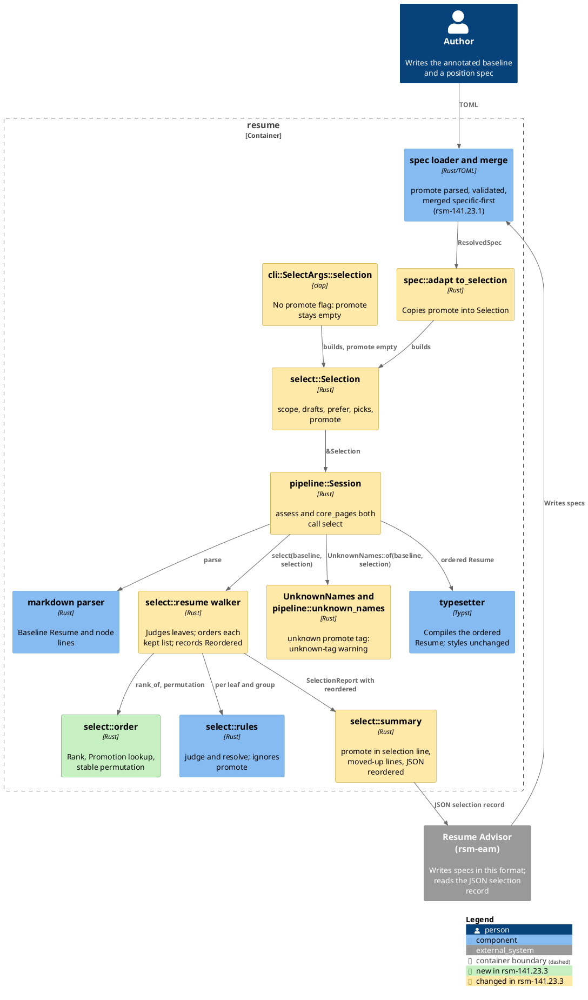
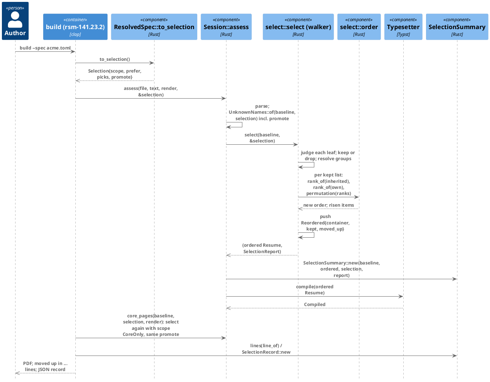

<!-- ABOUTME: Oracle analysis and TDD plan for rsm-141.23.3: ordering by promoted tags within each container. -->
<!-- ABOUTME: Evidence-first review at work/rsm-141.23.3 (base f9fadb5); read-only, nothing but this file was written. -->

# rsm-141.23.3: Ordering by promoted tags within each container

Date: 2026-11-21. Branch `work/rsm-141.23.3`, base `origin/main` f9fadb5.
Bead text: `history/rsm-141.23.3_ac-at-claim.md`. Evidence base: `resume-3/history/rsm-141.22_tailoring-decisions.md` (Addendum 1, D2), `rsm-141.22.2_oracle-analysis-and-plan.md`, `rsm-141.22.3_merged-baseline-probe.md`, and the two real drafts the decisions note measured (the owner's private hand-made drafts, read only; no text from them is copied here, bullets are named by their group id in the probe).

---

## 1. Functional intent (restated, with corrections)

**Restated.** A build today only keeps or drops items. It never changes their order, so one baseline shows every role's bullets in one fixed order. A reader gives a role's first bullets the most attention. A posting for a leadership role wants the leadership bullets first in each role, and a posting for a technical role wants the baseline order. Without this bead the only way to get both is to copy the baseline and reorder it by hand per audience. That fork has to be kept in step by hand forever. The evidence is the owner's "Org Leader" draft, which reorders the shared bullets of 4 of 9 roles.

This bead lets a position spec or profile carry an ordered `promote = ["tag", ...]` list in `[select]`. At build time, items that carry a promote tag move up inside their own list (stable, never across lists, never across containers). The build summary names what moved. One baseline then yields both orders, and the order is reproducible from the spec, byte for byte.

**Is it wrong or too narrow? Four corrections.**

1. *Narrow in what can move.* The bead says "items" and lists containers that include "a section's direct items". The model has paragraphs and bullets. This analysis recommends that **only bullets move**. Paragraphs, blurbs, roles, eras, and page breaks are fixed anchors. A resume with no bullets in a list has nothing to reorder, and prose order is meaning. The functional intent stands, but "items" must read "bullets".
2. *Wrong on one container.* "A parent bullet's children" does not exist in the model. The parser flattens nested bullets into siblings (finding 4 below). That clause cannot be implemented without a schema change and should be struck.
3. *Overstated evidence.* The bead says the rule "reproduces the Org Leader draft's order exactly in all four roles; CDK, Rightside, and Accenture need one tag each". That holds for the **bullets the two drafts share**. The Org Leader draft also places its leader-only (`#lead`) bullets in specific slots, and the baseline appends those at the end of each role. Reproducing the full draft order needs more rank tags: CDK 2, Rightside 3, and the HERE "AI and data platforms" era 3 (this era is not in the bead's four). Derivation in Q5. The intent is unaffected, but the acceptance test "reproduces the four roles exactly" must say which of the two it means.
4. *Missing interplay.* Tags drive selection and ordering. A promote tag put on an untagged bullet makes it "tagged", and under a tag selection that does not include the tag, the bullet is **dropped** (`select/rules.rs:69-79`). The intent ("one baseline, two orders") needs this documented and pinned by a test (Q7, O2).

---

## 2. Verdict, with confidence per decision

| # | Decision | Recommendation | Confidence |
|---|---|---|---|
| D1 | Where ordering lives | `promote: Vec<Tag>` on `Selection`; ordering applied **inside the resume walk**, per kept list, using a small pure module `select::order` (rank + stable permutation). Not a separate `order(Resume, &[Tag])` that callers must remember. | High |
| D2 | Sort domain | Each **list of bullets** (one `Bullets` block of a section or role, or one era's items) is one domain. Paragraphs, blurb, roles, eras, page breaks never move and nothing crosses them. Blocks are never merged or split. | High on the rule, medium that the owner never wants adjacent paragraphs ordered (O3) |
| D3 | Rank | The place in `promote` of the first promote tag in (inherited tags ∪ own tags); none gives last. An alternate group ranks by the union of its wordings' tags, as it is already judged. | High |
| D4 | Report | `SelectionReport.reordered: Vec<Reordered>`, one record per changed list: container `NodeRef`, kept count, and the items that rose (baseline `NodeRef`, old and new 1-based position). "Moved" means **rose**. | Medium-high |
| D5 | Summary and JSON | `promote` joins the selection line and the JSON record; one human line per changed list; JSON `reordered` carries the detail. Promote set but nothing rose prints `moved up: nothing`. | Medium-high |
| D6 | Unknown promote tag | Reuse `unknown-tag` (separate diagnostic, message prefix `promote`), through `UnknownNames`. No new code. | Medium-high |
| D7 | Determinism proof now | Library-level: spec fixture → `to_selection()` → `Session::assess` twice → identical PDF bytes, plus a negative control. The CLI-level twice-identical test and the guide section belong to rsm-141.23.2. | High |
| D8 | Tag interplay | Keep ordering orthogonal to selection. Document it and pin it with a test. Do not change `judge`. | Medium (O2) |
| D9 | Estimate | 1 to 1.5 days, not 0.5. | Medium |

---

## 3. Analysis

### 3.0 The dispatcher's findings, verified against the code

| # | Claim | Verdict | Evidence |
|---|---|---|---|
| 1 | `promote` parsed, validated, merged, printed; nothing reads it | **True** | `src/spec/raw.rs:83`; `src/spec/layer.rs:64,326-366`; `src/spec/merge.rs:18-19,79-83`; `src/spec/resolved.rs:177,191,197`. `to_selection` builds `Selection{scope, drafts, prefer, picks}` at `src/spec/adapt.rs:26-31` and never reads `promote`. `Selection` has no such field (`src/select/mod.rs:26-34`). A grep for `promote` in `src/` finds no reader outside the spec module. |
| 2 | `select` has three callers; summary shares one value; `is_silent` compares to default | **True**, plus detail | Callers: `src/pipeline.rs:117` (`assess`), `:172` (`core_pages`, scope forced to `CoreOnly` with `..selection.clone()` at `:168-171`), `src/commands/export.rs:71`. `doctor` reaches it through `assess` (`src/commands/doctor.rs:163,177`). `build` calls `core_pages` at `src/commands/build.rs:172`. `is_silent` at `src/select/summary.rs:80-87`. |
| 3 | A kept leaf carries only its own tags; inherited tags are recomputed in the walker; a group variant carries the union | **True** | `inherit()` `src/select/resume.rs:578-580`; section tags `:192`, role `:228`, era `:307`; union on the kept variant `:451-457`. Container annotations are cloned into the output (`:220`, `:281`, `:313`). A role's blurb tags do **not** flow to bullets (`:228` inherits from `role.annotations` only). |
| 4 | No nested-bullet container; flattening can separate parent and children | **True** | `Bullet{label, content, annotations}` (`src/model/mod.rs:110-117`). Flattening depth-first with a `NestedList` warning: `src/markdown/blocks.rs:822-893`, `src/markdown/lint.rs:23-28`. The parser knows the parent only to keep a parent and child out of one alternate group (`BulletOutline.nested_in`, `src/markdown/outline.rs:61-62`); the model does not keep it. Test pin: `src/markdown/blocks.rs:1252-1275`. |
| 5 | Container shapes; interleaving undefined by the bead | **True**, plus parser facts that decide the rule | Shapes: `src/model/mod.rs:44-107`. `Bullets` blocks join only when a comment line split one list (`continues`, `blocks.rs:659-671` for sections, `:806-813` for roles). A role's era absorbs bullets until a paragraph closes it (`blocks.rs:775-813`), so a role body is `[Paragraph \| Bullets \| Era]*` and a paragraph is what separates two lists. Generated test resumes have the same shapes (`tests/select_property_test.rs:134-220`). |
| 6 | "Never reorders" is asserted somewhere | **Partly.** No test in `src/select/tests.rs` asserts it (searched: no "order" assertion; line 45 is a doc comment). The assertions are elsewhere. | See the table in Q7 (every place that must change). |
| 7 | Unknown-name warnings hard-code `--tags` | **True** | `src/pipeline.rs:252-254` builds `format!("--tags {asked}")`. `export` also calls it (`src/commands/export.rs:69`). `ResolvedSpec::origin_of(&ChoiceKey::Promote(tag))` exists (`src/spec/resolved.rs:88`, `src/spec/merge.rs:80-82`). |
| 8 | `build --spec` does not exist | **True** | `docs/User-Guide.md:827` is a `guide:planned rsm-141.23 witness=option:--spec` stub; `tests/guide` fails when the witness exists, which forces 141.23.2 to rewrite the section. the `resume-1` worktree is on `work/rsm-141.23.2` with no changes at the time of this review. |

**One claim of the brief that is wrong:** "The repo has no existing PlantUML convention (ref/ contains none)." `ref/Cover-Letters-Architecture.md:62-89` and `ref/Cover-Letters-Analysis.md:400,439,1149` use ```` ```plantuml ```` blocks with `!include <C4/C4_Component>` and plain `Component`/`Rel`. The diagrams in section 7 follow that style (plus C4 element tags). I syntax-checked both diagrams with `plantuml -syntax` (read from standard input, so no file was written).

**One further fact that shapes the design.** Tags have two jobs: selection (`select/rules.rs:69-79`) and, after this bead, ordering. `judge` treats "tagged but not selected" as a drop, and "untagged" as general. The HERE pipeline era needs 4 rank tiers. Putting rank tags on bullets that were untagged changes their selection status. See Q7.

---

### Q1. Placement and shape

**Options.**

- **(A) Field on `Selection`; `select()` orders at its end, as a separate whole-resume pass.** One seam for every caller. `Selection::default()` equality and `is_silent` come for free. Needs the tailored resume's inherited tags recomputed (a second implementation of `inherit`) and a map from tailored nodes back to baseline node indices for the report (the tailored resume's `nodes()` indices differ from the baseline's; `NodeRef` docs, `src/select/resume.rs:60-69`).
- **(B) Separate pure `order(Resume, &[Tag]) -> (Resume, Moved)` that each caller invokes after `select`** (what the bead says literally). Callers today: `assess`, `core_pages`, `export`, plus 141.23.2's path. Any one that forgets it builds a different document from the others. `core_pages` documents that it "equals what a `--core-only` build would print" (`src/pipeline.rs:140-141`). A forgotten call silently breaks that. The summary would also need the promote list passed separately, and `is_silent` would not see it. **Rejected.**
- **(C) Ordering inside the walker, with `promote` a field of `Selection`.** The walker already has, at the moment it holds a list of kept bullets: the inherited tags (`bullets(items, tags, gate)`, `resume.rs:317`), the baseline node index of every item (`self.index()`, `:321`), and the container's `NodeRef` (`node` in `section`, `role`, and `era`). The report needs exactly these.

**Recommendation: (C), with the arithmetic in a pure module.** Concretely:

- `Selection.promote: Vec<Tag>` ("most promoted first; a repeated tag counts at its first place; resume only, the letter selection never reads it").
- New `src/select/order.rs`: `Rank`, `Promotion`, `permutation`, `risen`. All pure, generic, and independent of the model. It holds the rule; the walker holds the container knowledge.
- `Walker::bullets` takes the container's `NodeRef`, collects `(baseline_index, Bullet)`, applies the permutation, and pushes a `Reordered` record. Three call sites change: section (`resume.rs:207`), role (`:259`), era (`:307`).
- `select()` therefore returns an ordered resume and a report that says what moved. `assess`, `core_pages`, and `export` change nothing. 141.23.2 gets ordering by calling `to_selection()`.

**Why this beats (A) on design, not only on effort.** (A) needs a second implementation of "inherited tags" and a tailored-to-baseline index map. Those are exactly the kind of duplicated logic that drifts. The walker has both facts at hand. The pure module keeps the rule unit- and property-testable without a `Resume`.

**What the bead's step 2 loses.** There is no public `order(Resume, &[Tag]) -> Resume`. Nothing in the bead's acceptance criteria needs one. "Order is idempotent" is tested as `select(select(x)) == select(x)` with promote set, which the existing property already does for selection.

**Compile-time enforcement.** `Selection` is built by field in exactly two production places: `src/cli.rs:306-311` and `src/spec/adapt.rs:26-31`. Both list every field, so adding `promote` fails the build until each states its value. The other construction sites use `..Selection::default()` (`tests/guide/main.rs:914-971`, `src/select/rules.rs`, `src/select/tests.rs`) and are unaffected. One test builds the full struct: `tests/select_property_test.rs:254-268`.

**`Selection::default()` and `is_silent`.** An empty `promote` is the default, so a default selection is unchanged. A non-empty `promote` makes the selection non-default, so the summary speaks (it should: the order is not the baseline's). No code is needed for that. A test pins that `reordered` non-empty implies `!is_silent` (it cannot be otherwise, because `reordered` is empty without a promote list).

**`core_pages`.** `Selection{scope: CoreOnly, ..selection.clone()}` (`pipeline.rs:168-171`) carries `promote`, so "core alone: N pages" is measured on the same order as a `--core-only` build with that spec. A test pins the equivalence (Q5).

**Merge conflicts with rsm-141.23.2.** The files this bead touches that 141.23.2 might also touch are small and additive:

| File | This bead | Expected overlap |
|---|---|---|
| `src/spec/adapt.rs` | one field in `to_selection`, one test | Low. 141.23.2 calls `to_selection`; it does not change it. |
| `src/cli.rs` | `promote: Vec::new()` in `SelectArgs::selection` (`:306-311`) | Low. 141.23.2 adds `--spec` to `BuildArgs`, a different hunk. |
| `src/pipeline.rs` | one block in `unknown_names` | Low-medium. Tell 141.23.2 not to restructure `unknown_names` and to relabel `--tags`/`--prefer` for spec sources in its own hunk. |
| `src/select/summary.rs` | selection line, `lines`, record | Medium if 141.23.2 adds a spec line to the summary. Ask it to add its own function, not edit `selection_line`. |
| `ref/Resume-RS-Architecture.md` | selection section text, line 922 comment, a dated log entry at the end | Both append at the file's end. Trivial to resolve; expect one conflict. |
| `docs/User-Guide.md` | the generated `unknown-tag` row only | Re-run `bless_guide_tables` after merging. |
| `tests/fixtures/specs/README.md` | one new row | Trivial. |

Rejected variant (A3): a resume-only wrapper (`Tailoring{selection, promote}`) so letters never see the field. It adds a second argument to every caller, which is the forgetting problem again. The field's documentation and the letter spec's missing `promote` key (`ref/Cover-Letters-Analysis.md:947`) are enough.

**Confidence: high.**

---

### Q2. The exact ordering rule

#### The domain (finding 5)

Leaves are paragraphs, blurbs, and bullets. **Only bullets are sorted.** The unit is a **list**:

> A *list* is one `Block::Bullets` of a section, one `RoleBlock::Bullets` of a role, or the `items` of one `RoleBlock::Era`.

The rule, total over every resume:

> For each list L, in document order: compute each kept item's rank; replace L with L stably sorted by rank. Touch nothing else.

Consequences, each of which is a documented behavior:

| Situation | Behavior |
|---|---|
| Section with `[Paragraph, Bullets, Role, Role, PageBreak]` | The bullets are one list. The paragraph, the roles, and the page break stay where they are. |
| Role body `[Bullets, Paragraph, Bullets]` | Two lists. A promoted bullet in the second never rises above the paragraph. |
| Section `[Bullets, PageBreak, Bullets]` | Two lists. The page break is a layout position and nothing crosses it. |
| Role with eras | Each era is its own list. Role-level bullets (before the first era) are another. Nothing moves between an era and its role, or between eras. |
| Role blurb (`Role.blurb`, a field, not in `body`) | Never reordered. A chosen blurb wording that was a paragraph keeps its existing promotion into the blurb slot (`resume.rs:246-251`). |
| Alternate groups | Resolved before ordering. The chosen wording sits in the group's place, ranked by the group's union tags (below). |
| `@draft`, `@verify`, `@core`, `@extra` | Irrelevant to rank. Selection decides keep or drop first. Under `--drafts` a draft bullet is ranked like any other. |
| Nested bullets | The model has no children (finding 4). A flattened child is an ordinary sibling and can separate from its parent if its tags differ. See below. |

**Why per list and not "runs of leaves between anchors".** Sorting paragraphs and bullets together would have to rebuild blocks: bullets that stop being adjacent split a `Bullets` block, bullets that become adjacent merge. That changes the JSON structure styles read (`Block::Bullets{items}` boundaries) and the layout. Per list keeps the JSON shape identical. Only the order of `items` changes. The generator and typesetting code do not need to know ordering exists. A "kind-preserving slot" scheme (leaves permute within the slots of their own kind) gets the same effect with much more machinery and a rule nobody could state in one sentence.

**What it costs.** A promoted bullet cannot rise above a paragraph in the same container. In the real baseline, a role's bullets are one list, so the four roles are unaffected (probe: no role has body paragraphs). The Org Leader `Summary` section is a paragraph followed by bullets. The intro paragraph stays first, which is the correct behavior.

**Nested bullets.** Recommended behavior: a flattened child is a sibling, ranked on its own tags. The documentation says so in one sentence: "nested lists are already flattened to one level (`nested-list`), so a child orders on its own tags; to keep a child under its parent, give both the same promote tag". A test pins it. The alternative, keeping a parent and its children together, needs a model change (a `children` field or a parent index) and a schema change; no evidence calls for it, and `nested-list` already warns authors that the structure is lost. If the owner ever wants it, it is an additive model change later.

#### The rank

```
rank(item) = min over t in (inherited(item) ∪ own(item)) of place(t)   // place(t) = index of t in promote
           = Unpromoted (sorts after every place) when no tag of the item is in promote
```

Facts that follow, and that the code and tests rely on:

1. **Inherited tags are the same for every sibling in a list.** All items of one list share their ancestors, so `inherited` is a per-list constant. The code computes `cap = rank_of(inherited)` once per list and each item's rank is `min(cap, rank_of(own))`. This is the whole of "after inheritance".
2. **The cap flattens ranks.** If a role carries a promote tag at place `k`, every untagged bullet under it ranks `k`, not "last", and a bullet whose own tag has a later place also ranks `k`. Example: promote `[people, leadership, scale]`, role tagged `#leadership`, bullets `a` (untagged), `b #scale`, `c #people`. Ranks: `a`=1, `b`=1, `c`=0, so the order is `c, a, b`. Without inheritance it would be `c, b, a`. This is the rule as written, and it is surprising enough to need one documented example and a test.
3. **First place wins, not first tag.** A bullet tagged `#leadership #people` with promote `[people, leadership]` ranks 0. The order of tags on the line does not matter (tags are a set).
4. **A group ranks by the union of its wordings' tags.** The kept wording carries `group.facts.tags` (`resume.rs:451-457`), the same set the group is judged by. This makes ordering idempotent and consistent with selection. It also means a tag written on any wording of a group promotes the whole group. In the merged baseline probe every group's wordings carry `#arch` or `#lead`, so promote tags would normally go on the group's wordings together.
5. **Rank does not depend on position.** After sorting, ranks are non-decreasing. Sorting again with the same keys is the identity. That is the whole idempotence argument.

**Efficiency.** `Promotion` holds a `BTreeMap<&Tag, usize>` built once per `select` (O(P log P)). A rank is O(t log P) for t tags on the item. A list is sorted in O(n log n) with `sort_by_key` on an index vector (stable, in `std`). With an empty promote list the walker skips all of it (`Promotion::is_empty()`), so existing specs cost nothing and take a path that cannot differ from today's. `BTreeMap`, not `HashMap`, to match the crate's habit of ordered containers in anything that feeds output (no hash iteration exists on this path either way).

#### Properties: by construction versus tested

| Property | By construction? | How it is held |
|---|---|---|
| Output is a permutation within each list | Yes (a sort of an index vector never drops or repeats an index) | Unit test on `permutation`; end-to-end property over generated resumes (guards the wiring) |
| Empty list is the identity | Yes (`is_empty()` early return; the default selection path is the current code) | Existing identity property keeps passing; new test with an explicit empty list |
| Stable (equal ranks keep their order) | Yes (`slice::sort_by_key` is stable) | Property against an **independent rank oracle** computed from container annotations in the test |
| Idempotent | Yes given fact 5 | Property: `select(select(x)) == select(x)` with promote set, and `reordered` empty on the second run |
| Nothing crosses a list or a container; containers keep their order; paragraphs, blurb, page breaks fixed | Yes (the walker orders a `Vec<Bullet>` it owns before placing it in its block) | Property: structural skeleton (everything except the order inside lists) is equal with and without promote |
| JSON/model otherwise unchanged | Yes | Same skeleton property; schema stays 1 |
| The rank rule, including inheritance and the cap | **No** | Needs the independent oracle (the test file already carries each leaf's container annotations, `tests/select_property_test.rs:277-340`) plus the hand-written examples above |
| Group union ranking | **No** | Hand-written unit test |
| Report accuracy (what "rose" means; positions; baseline indices) | Partly | Property over generated resumes; hand-written examples |
| Determinism across runs and machines | Yes (no hash order, clock, or locale on the path) | Byte-identity test (Q5) |

**Confidence: high** on the rule; the paragraphs-never-move choice is medium (O3).

---

### Q3. Reporting

**What "moved" means.** An item **rose** when its position in its list after ordering is smaller than before: `to < from`, positions 1-based among the items the build kept in that list (dropped items do not count; the reader sees the kept list). Items that fell (displaced by the ones that rose) are not listed.

Why "rose", and not "position changed" or "carries a promote tag":

- It is the property the user asked for ("what moved up"), and the set that explains the change: if anything changed, at least one item rose, and every fallen item fell because one rose past it.
- "Carries a promote tag" would list items that were already first. A reader would conclude they moved.
- "Position changed" lists both sides and doubles the output for no added information.

**Report types** (`src/select/resume.rs`, exported from `src/select/mod.rs` next to `Dropped` and `Chosen`):

```rust
/// A list of bullets in which promotion moved something up, in document order with the other records.
#[derive(Debug, Clone, PartialEq, Eq)]
pub struct Reordered {
    /// The section, role, or era that holds the list; named by its index in the baseline's `nodes()`.
    pub container: NodeRef,
    /// How many bullets the list kept.
    pub kept: usize,
    /// The bullets that now sit higher than before, top first.
    pub moved_up: Vec<MovedUp>,
}

/// A bullet that rose: its baseline node, and where it was and is among the list's kept bullets (1-based).
#[derive(Debug, Clone, PartialEq, Eq)]
pub struct MovedUp {
    pub node: NodeRef,
    pub from: usize,
    pub to: usize,
}
// SelectionReport gains: pub reordered: Vec<Reordered>
```

- Naming: a `NodeRef` already carries kind, label, and the **baseline** node index (`resume.rs:60-69`). The walker records baseline indices as it goes, so the human summary and the JSON record can map to source lines through `Parsed::node_lines` with no new mechanism. This is the decisive advantage of ordering in the walker (Q1).
- One record per list, not per container. A role with two lists can have two records with the same container. That is rare, honest, and avoids a merge step.
- `SelectionReport` derives `Default, PartialEq, Eq` (`resume.rs:15`), so `reordered: Vec::new()` keeps the existing identity assertions (`tests/select_property_test.rs:491-497`, `src/select/tests.rs:104-107`) true.

**Human lines** (`SelectionSummary::lines`, `src/select/summary.rs:96`). The selection line gains `promote a, b` after `prefer`:

```
selection: tags leadership, people, platform; promote people, leadership
```

One line per changed list, right after the `wordings:` line and before the surprise lines (routine and requested, so ahead of the "surprises"):

```
moved up in role at line 7 "Analytical Engines Ltd · Principal Engineer": 3 of 5 bullets (lines 12, 11, 13)
```

Format: `moved up in {at(container)}: {n} of {kept} bullet{s} ({lines})`, where `{at(container)}` is the existing `at` closure (`summary.rs:106-109`), and the parenthesis lists the moved bullets' source lines top first, omitted when any line is unknown. The human output names each list and each bullet's line. It does not repeat the bullet text; the JSON does. A 9-role baseline with 5 changed lists adds 5 lines. The measured summaries today are 9 and 14 lines (`ref/Resume-RS-Architecture.md:1038`), so this fits.

When promote is set and nothing rose, one line says so, so a typo or an already-first list is not mistaken for a bug in the feature:

```
moved up: nothing
```

(Unknown tags are reported separately and earlier, Q4.)

**`is_silent`.** Unchanged code. `selection != Selection::default()` already holds whenever `promote` is non-empty. It prints the selection line, the counts line, and `moved up: nothing` or the per-list lines. A resume with no annotations and no promote builds exactly as before.

**JSON `selection` record** (`SelectionRecord`, `summary.rs:225-251`). Two additive keys, always present:

```json
"prefer": ["leader"],
"promote": ["people", "leadership"],
...
"verify": [],
"reordered": [
  {
    "container": {"kind": "role", "line": 7, "label": "Analytical Engines Ltd · Principal Engineer"},
    "kept": 5,
    "moved_up": [
      {"kind": "bullet", "line": 12, "label": "Hired 4 engineers in a quarter.", "from": 4, "to": 1},
      {"kind": "bullet", "line": 11, "label": "Mentored 6 engineers through promotion.", "from": 3, "to": 2},
      {"kind": "bullet", "line": 13, "label": "Gave 5 business customers control of their budget.", "from": 5, "to": 3}
    ]
  }
]
```

`promote` goes after `prefer` (inputs together). `reordered` goes after `verify`. Existing keys keep their relative order, so the "additive, every key always present, in this order" contract holds. JSON objects are unordered, and the tests index by key (`tests/tailoring_test.rs:167,183,215`). If the owner reads "in this order" strictly as "append only", move both keys to the end; no code differs. `SelectionRecord` stays derived from the same `SelectionSummary` as the human lines, so they cannot disagree.

**Confidence: medium-high.** The shape is sound; the exact human wording is a judgment call (O4).

---

### Q4. Unknown promote tags

**Shape.** `UnknownNames` gains `promote: Vec<Tag>` (promote tags no node carries, deduplicated, in promote order). `UnknownNames::of` already computes the known set from every node of the whole baseline, containers and drafts included (`src/select/mod.rs:82-89`), so a tag used only on a section, or only on a draft, is known, as it is for `--tags`.

**Code.** Reuse `DiagnosticCode::UnknownTag`.

- It is the same mistake with the same remedy (a name the file does not use, listing the ones it does, `resume tags <file>`).
- A new code touches `code.rs:108-109,180,253,337` (variant, category, severity, and a test list that names the two warning-only codes), `advice.rs`, and the generated guide table, and gives a consumer a second code to learn for one concept. The advisor (rsm-eam) already filters on `unknown-tag`.
- The cost of reuse is that the JSON `code` cannot tell a `--tags` typo from a `promote` typo. The message prefix does, and the severity and remedy are the same.

**Message and hints** (one more `finding(...)` call in `pipeline::unknown_names`, `src/pipeline.rs:249-256`, beside the existing two):

```
warning[unknown-tag]: promote `lede`: not used in Resume.md
  the resume's tags are `arch`, `lead`
  `resume tags <file>` lists every tag and wording
```

The prefix is `promote` because promote is reachable only from a spec file (`SelectArgs` has no promote flag, `src/cli.rs:299-312`). It is a separate diagnostic from the `--tags` one, so each names its source. Advice text (`src/diagnostics/advice.rs:485-490`) widens to "A tag named by --tags, or by a spec's `promote` list, is not used anywhere in the resume." The example pair stays valid. The generated guide table row at `docs/User-Guide.md:957` changes, so run `cargo test --test guide -- --ignored bless_guide_tables` and commit the result.

**Spec file and line.** The `Diagnostic` carries a span into the Markdown, not into a TOML file, and `Session::assess` does not know the spec. `ResolvedSpec::origin_of(&ChoiceKey::Promote(tag))` already gives the file and line. Wiring it is a few lines at the point where a command holds both the spec and the findings, which is 141.23.2's `build --spec`. Building a locator now would be unused code. **Hand it to 141.23.2** as a stated follow-up: append `set at acme.toml:7` as a hint. For the same reason, relabeling spec-sourced `--tags` and `--prefer` findings is 141.23.2's job (it is the one that introduces spec-sourced tags).

**Warn, not error.** Picks are an error when unknown (`ResolvedSpec::check_picks`, `adapt.rs:66-94`) and tags are a warning. The bead says warn, which matches `--tags`. A typo in `promote` fails soft (nothing moves, and `moved up: nothing` says so). Whether a spec should treat it as an error is the owner's call (O5); the default stays the bead's.

**Confidence: medium-high.**

---

### Q5. Test strategy

#### The four draft orders: what the files give, and what they do not

The target orders **are recoverable** from the owner's hand-made Org Leader draft (private, read-only) and the probe `rsm-141.22.3_merged-baseline-probe.md`. The promote **tags are not**: no file assigns rank tags to bullets (the probe has only `#arch`, `#lead`, and group names). The tag names and the tag assignment are therefore test inputs, chosen to produce the target.

Method. Take the probe's baseline order for a `--tags lead --prefer leader` selection. That selection keeps untagged bullets, `#lead` bullets, and the `.leader` wording of each group. Number the kept bullets 1..n in baseline order. Read the Org Leader draft's order for the same role and write it as those numbers. For a stable sort by rank, the fewest rank tiers equals the number of maximal ascending runs of the target. Each descent forces a new tier, and equal-rank items keep baseline order. The last tier can be untagged, so tags needed = runs − 1.

Probe item ids (group ids `wN` are the probe's):

Bullet text is redacted for publication: `wN` is a probe group id, `uN` an untagged bullet, `lN` an ungrouped `#lead` bullet.

| Role or era | Baseline order for the leader selection (probe ids) |
|---|---|
| HERE, Pipeline and analytics platform (9) | 1=w7, 2=w8, 3=untagged u1, 4=w9, 5=w10, 6=untagged u2, 7=w11, 8=w12, 9=w13 |
| CDK Global (7) | 1=w14, 2=untagged u3, 3=w15, 4=w16, 5=untagged technologies line, 6=`#lead` l1, 7=`#lead` l2 |
| Rightside (7) | 1=w17, 2=w18, 3=w19, 4=w20, 5=untagged technologies line, 6=`#lead` l3, 7=`#lead` l4 |
| Accenture (6) | 1=w25, 2=w26, 3=untagged u4, 4=w27, 5=untagged u5, 6=`#lead` l5 |
| HERE, AI and data platforms (11), not one of the four | 1=w1, 2=untagged u6, 3=w2, 4=w3, 5=w4, 6=w5, 7=w6, 8=`#lead` l6, 9=`#lead` l7, 10=`#lead` l8, 11=`#lead` l9 |

Targets (Org Leader draft lines 50-58, 64-70, 76-82, 101-106, 32-42), and the result:

| Role | Target (baseline numbers) | Ascending runs | Rank tiers = tags needed (full) | Shared-bullets-only target | Tags (shared only) |
|---|---|---|---|---|---|
| HERE pipeline era | 1 2 3 9 6 5 4 8 7 | [1 2 3 9] [6] [5] [4 8] [7] = 5 | **4** | same (every bullet is shared) | 4 |
| CDK | 1 6 3 7 2 4 5 | [1 6] [3 7] [2 4 5] = 3 | **2** | 1 3 2 4 5 → [1 3] [2 4 5] | **1** (2 moved) |
| Rightside | 1 4 2 6 3 7 5 | [1 4] [2 6] [3 7] [5] = 4 | **3** | 1 4 2 3 5 → [1 4] [2 3 5] | **1** (2 moved) |
| Accenture | 2 4 5 1 3 6 | [2 4 5] [1 3 6] = 2 | **1** (3 moved) | same | 1 |
| HERE AI era (extra) | 1 2 8 3 9 4 5 6 10 7 11 | [1 2 8] [3 9] [4 5 6 10] [7 11] = 4 | **3** | 1 2 3 4 5 6 7 (no change) | 0 |

The shared-bullets column reproduces the decisions note exactly (5 runs for the HERE era with four tags; 1, 1, 1 tags for CDK, Rightside, Accenture; 2, 2, 3 bullets moved). That agreement is the evidence that the probe's order is the one the analysis used. The full column is new: **the bead's "one tag each" and "exactly" hold for the shared bullets only.** Once the leader-only bullets take the slots the draft gives them, CDK needs 2 tags and Rightside 3, and the AI era (not one of the four) needs 3.

**Owner question O1.** Does the owner want the build to reproduce the leader-only bullets' slots (more rank tags per role), or to put leader-only bullets last (fewer tags, a build that differs from the hand-edited draft)? Default: test both, and let the owner choose how much to tag in the real annotated baseline (rsm-141.13). The probe is a generated merge, not the owner's final baseline, so any numbers here must be re-derived there. If the owner's baseline orders bullets differently, the run counts change, but the method does not.

**Fixtures are synthetic.** Roles with bullets `b1..bN` and rank tags `r1..r4`. The repo's guide check keeps private details out of the guide, and the same discipline applies to fixtures. No draft text enters the tree.

Fixtures (all through `select` with a promote list; expected order of ids):

| Case | Tags | `promote` | Expected |
|---|---|---|---|
| pipeline era (9) | b1 b2 b3 b9 `#r1`; b6 `#r2`; b5 `#r3`; b4 b8 `#r4`; b7 none | `[r1 r2 r3 r4]` | b1 b2 b3 b9 b6 b5 b4 b8 b7 |
| CDK shared (5) | b1 b3 `#r1` | `[r1]` | b1 b3 b2 b4 b5 |
| CDK full (7) | b1 b6 `#r1`; b3 b7 `#r2` | `[r1 r2]` | b1 b6 b3 b7 b2 b4 b5 |
| Rightside shared (5) | b1 b4 `#r1` | `[r1]` | b1 b4 b2 b3 b5 |
| Rightside full (7) | b1 b4 `#r1`; b2 b6 `#r2`; b3 b7 `#r3` | `[r1 r2 r3]` | b1 b4 b2 b6 b3 b7 b5 |
| Accenture (6) | b2 b4 b5 `#r1` | `[r1]` | b2 b4 b5 b1 b3 b6 |
| AI era (11) | b1 b2 b8 `#r1`; b3 b9 `#r2`; b4 b5 b6 b10 `#r3` | `[r1 r2 r3]` | b1 b2 b8 b3 b9 b4 b5 b6 b10 b7 b11 |

Each fixture also asserts the unpromoted build (empty promote) gives `b1..bN`, which is the negative control that the promote list did the work.

Nothing-crosses fixture: two roles, a promoted bullet in the second and none in the first; the first is untouched and the second's bullet stays in the second. A section-level fixture: bullets either side of a paragraph and of a page break.

#### Unit and integration placement

| Where | What | Why there |
|---|---|---|
| `src/select/order.rs` `#[cfg(test)]` | `Rank` order; `Promotion::rank_of`; `permutation`; `risen`; a small `proptest` on arbitrary rank vectors | Pure functions with no resume; the crate already puts proptest in unit modules (`src/spec/merge.rs:311-371`) |
| `src/select/tests.rs` | Rule and report behavior through `select` with parsed Markdown: containers, anchors, inheritance and the cap, group union, blurb, drafts, nested bullets, tag interplay, report shape, summary lines, JSON record, `UnknownNames` | This file already holds the `select` and summary behavior tests and has the `resume()`, `leaves()`, `summary()` helpers (`:11-66`, `:599-603`) |
| `src/pipeline.rs` `tests` | `assess` returns an `unknown-tag` finding for an unused promote tag | Same place as the other `assess` tests (`:316-385`) |
| `src/spec/adapt.rs` `tests` | `to_selection` copies `promote` in merged order | Same place as the other adapter tests (`:97-268`) |
| `tests/select_property_test.rs` | Properties over generated resumes (below) | Generators and the leaf reader live here |
| `tests/ordering_test.rs` (new) | The seven draft-shaped fixtures; spec fixture to ordered PDF text; determinism; `core_pages` equivalence; unknown tag at `Session` level | Needs the public API only (`Session`, `Cli::try_parse_validated`, `ResolvedSpec`); same style as `tests/tailoring_test.rs` and `tests/determinism_test.rs` |

#### Property tests

Reuse in `tests/select_property_test.rs`: `resume_strategy()` (`:225-236`), the `Leaf`/`leaves()` reader that carries each leaf's container annotations (`:277-340`), and the unique leaf ids `n1, n2, ...`. `Note` tags come from the pool `a b c`. Add:

```rust
fn promote_strategy() -> impl Strategy<Value = Vec<Tag>>   // subsequence of [a b c d], shuffled, 0..=4 long
fn promoting(selection: Selection, promote: Vec<Tag>) -> Selection
```

Keep `selection_strategy()` promote-free (its struct literal at `:254-268` gains `promote: Vec::new()`), so the existing "keeps order" property stays true and meaningful. New properties, each over `resume_strategy()`, `selection_strategy()`, and `promote_strategy()`:

1. `promotion_only_reorders_bullets_within_their_own_list`: compare `select(r, base)` and `select(r, base+promote)`. The skeleton (every node except the order of `items` in each list: section/role/era titles and annotations, paragraph and blurb text and position, page-break positions, block boundaries) is equal, and each list's ids are a permutation of the promote-free list's ids.
2. `each_list_is_sorted_by_the_rank_the_rule_gives_and_equal_ranks_keep_their_order`: an **independent oracle** computes rank from `Leaf.containers` and `Leaf.annotations.tags` (min place over the union, else last) and asserts non-decreasing ranks per list and, for equal ranks, the promote-free relative order. This is the only check of inheritance and the cap, so it is the most valuable property.
3. `ordering_is_idempotent_and_a_second_selection_moves_nothing`: `select(select(r)) == select(r)` and `second.reordered.is_empty()`.
4. `an_empty_promote_list_is_the_identity`: the output with `promote: vec![]` equals the existing output (a guard on the fast path).
5. `the_reordered_report_names_what_rose`: every `moved_up` node is the baseline node at that index (kind `Bullet`, label equal to the leaf id), `to < from`, `kept` equals the list length, and the set of ids that rose equals the set of ids whose position decreased between the two outputs. Records appear in document order.
6. `a_summary_with_a_reorder_is_never_silent`.

Edit `selection_keeps_eligible_core_renders_one_wording_keeps_order_and_is_idempotent` (`:421`): its subsequence assertion (`:431`) is correct only with an empty promote list, which the unchanged strategy guarantees. Add a comment saying so, and rename the ABOUTME line "what keeps its order" to "what keeps its order when nothing is promoted" (`:1-2`).

Generator limit: the existing role generator emits one bullet list per container (`:195-216`). Multi-list containers (bullets, paragraph, bullets; bullets, page break, bullets) get hand-written tests. Do not extend the generator unless a property over multi-list containers is wanted. The skeleton property already covers the structure.

Run `cargo mutants -f src/select/order.rs` and on the walker's new lines. The rule is small and exact, which suits mutation testing. Expect survivors only in the human-line wording.

#### Determinism proof without `--spec` (finding 8)

`Session`, `Session::assess`, `Rendered::Laid`, `Compiled::export_pdf`, `Cli::try_parse_validated`, and `ResolvedSpec::to_selection` are all public, and integration tests already use the CLI parser (`tests/tailoring_test.rs:269`, `tests/common/workspace.rs:11`). So the end-to-end determinism test needs no `--spec` flag:

1. A new case `tests/fixtures/specs/promote/` (its own `baseline.md` and `positions/acme.toml` with `[select] tags = [...] promote = ["people", "leadership"]`, `content = "../baseline.md"`). Do not edit the shared `tests/fixtures/specs/baseline.md` or any existing case; 141.23.2 builds from them.
2. `resolve(spec)` → `to_selection()` → `Session::open(&render, None)` → `assess(file, text, &render, &selection)` twice, extract `Rendered::Laid{compiled}`, `compiled.export_pdf("promote")`, and assert the two byte vectors are equal. Use the bundled fonts (`--fonts bundled`) as the unit tests do.
3. Negative controls: with `promote` emptied the bytes **differ**; and the PDF text shows the promoted bullet above the one it overtook (`tests/common/mod.rs:199-216` `page_texts`/`position`).
4. A `to_selection` test pins that the spec's merged promote list arrives in `Selection.promote` in order. The compiler already forces the field to be set; this checks the value.

What is left for 141.23.2: the same two builds through the CLI (`build --spec ... ` twice, byte-identical PDF and JSON record), using the fixture above. It adds no code to this bead's path.

#### Worked example for the guide, and the split with 141.23.2

The guide example cannot run for a user until `--spec` exists, and the guide's rule is that a documented feature works (`docs/User-Guide.md:829-831`). Adding promote text to the planned stub would collide with 141.23.2, which rewrites that whole section. Recommended split:

- **This bead:** the synthetic fixture (`tests/fixtures/specs/promote/`), the tests above (which assert the exact order and the exact summary line and JSON below), and a ready-made guide subsection kept in the bead notes (not in `docs/`). It does not touch `## Profiles and position specs`.
- **141.23.2:** pastes that subsection into its rewritten section as "Ordering with promote", adds the guide test binding (parse the fenced example, apply the spec, assert the order, as `tests/guide/main.rs:884-933` does for wordings), and the CLI twice-identical test.

Fixture content for the worked example (synthetic; role at line 7, bullets at lines 9 to 13):

```markdown
### Analytical Engines Ltd · Principal Engineer · 2017 – Present

- Cut a weekly run from $39K to $29K by caching 80% of the tables. <!-- #platform -->
- Led delivery of the engine gateway to 5 customers in 3 months. <!-- #platform -->
- Mentored 6 engineers through promotion. <!-- #leadership -->
- Hired 4 engineers in a quarter. <!-- #leadership #people -->
- Gave 5 business customers control of their budget. <!-- #leadership -->
```

Spec: `tags = ["platform", "leadership", "people"]`, `promote = ["people", "leadership"]`.

Result order: Hired (place 0 through `#people`, though it also carries `#leadership`), Mentored, Gave (place 1), Cut, Led (last, baseline order kept). Summary:

```
selection: tags leadership, people, platform; promote people, leadership
moved up in role at line 7 "Analytical Engines Ltd · Principal Engineer": 3 of 5 bullets (lines 12, 11, 13)
```

This one example shows: first place wins over tag order, equal ranks keep order, and a bullet moving past others it was below.

**Confidence: high** on structure; medium on the derived tier counts until re-derived on the owner's real baseline (O1).

---

### Q6. Enterprise-scale check

The brief assumes 5,000+ employees, hundreds of concurrent users or systems, very large geospatial tables, and 5,000-column tables. This crate is a single-user, single-process CLI that turns one Markdown file of a few hundred lines into a PDF.

**Not relevant, and why.**

- Hundreds of concurrent users or systems: there is no server, no shared state, and no global. `select` is a pure function of its two arguments. `Session` is read-only after `open`. Nothing in this change adds shared mutable state. (If the library were ever embedded in a service, a pure `select` makes that safe, and the new code does not change it.)
- Very large tables and 5,000-column tables: the data is a list of bullets. The largest realistic list is tens of items. Sorting a list is O(n log n); a million-bullet input is not a use case, and the whole walk is already linear in nodes. No batching, partitioning, or yielding applies.
- 5,000+ employees: no multi-tenant concern. A resume never contains another person's data.

**Relevant here.**

- *Large baselines and `watch`.* A baseline is a few hundred nodes. `watch` rebuilds on every save. Ordering adds a `BTreeMap` build per `select` and a sort per kept list: microseconds against a Typst compile of tens of milliseconds (the core-only extra compile is "about 40 ms for a 5-page resume", `ref/Resume-RS-Architecture.md`, selection section). The empty-promote fast path costs nothing for every existing spec.
- *Determinism.* The product claim is that the order is reproducible from the spec. No hash iteration, clock, locale, or thread order is on the path. `Tag` compares by its string. A byte-identity test proves it (Q5).
- *JSON record size and stability.* `reordered` is bounded by the number of bullets in changed lists, with a label (at most 8 words, `resume.rs:82-89`) per moved bullet. For the owner's baseline that is under a few kilobytes. The record is additive, so existing consumers keep working. The advisor (rsm-eam) writes specs in this format: the TOML key `promote` is already accepted (rsm-141.23.1), so a spec it writes loads on this binary. A consumer reading `reordered` gets baseline line numbers, which are stable for the same file.
- *Back-compat for downstream readers of the spec format.* `deny_unknown_fields` on specs means an older binary rejects nothing new here (`promote` is not new to the parser).
- *Privacy.* The summary prints bullet line numbers and, in JSON, the first eight words of a moved bullet, as it already does for dropped and verify items. Nothing new leaves the machine. Fixtures and the guide example use synthetic text.

**Confidence: high.**

---

### Q7. Disagreements with the bead, and what this surfaces

**Disagreements and underspecifications**

1. **"A pure `order(Resume, &[Tag]) -> Resume`, after `select`".** Replace with a field on `Selection` and ordering in the walker (Q1). It cannot be forgotten, needs no second inheritance implementation, and gives baseline indices to the report.
2. **"a parent bullet's children".** Not a container in the model; strike it. Document that flattened children are siblings (Q2).
3. **"a section's direct items, a role's body".** Underspecified. Replace with "each list of bullets" (Q2).
4. **"the summary line naming what moved".** One line per changed list plus JSON detail; "moved" defined as "rose" (Q3).
5. **Plan step 1 ("promote in the spec and profile types and the merge") is done.** rsm-141.23.1 landed it. Acceptance criterion 1's first half ("merges like prefer") is already true and tested (`src/spec/merge.rs:268-290`). What the bead is missing is the one step that makes `promote` do anything: **`to_selection` must copy it** (`src/spec/adapt.rs:26-31`). Without it the feature is unreachable. Add it as an explicit task.
6. **Test plan item "build --spec twice is byte-identical".** Cannot run; replace with the library-level proof now and hand the CLI one to 141.23.2 (Q5).
7. **"User Guide: one worked example on the synthetic fixture".** Cannot land in a section that is a planned stub; hand off (Q5).
8. **"Exactly in all four roles; one tag each".** True only for the shared bullets (Q5). Make the fixtures say which.
9. **0.5 d estimate.** The bead covers the function, the summary, and a guide example. The work this analysis finds adds: the walker integration and report type, the JSON record, `UnknownNames`, the `unknown-tag` advice and generated-table change, property tests with an independent oracle, the spec fixture and Session-level determinism test, and doc updates. Realistic: 1 to 1.5 days.
10. **Interplay with `core-only`.** `promote` with `core-only = true` is valid: core items are ordered by tag. `core_pages` orders its own selection with the same list. No conflict with `ScopeConflict` (which is tags versus core-only).
11. **Interplay with `--drafts`.** Preview drafts rank like any bullet. A draft wording picked by the spec is still an error (`PickedDraft`); ordering never runs on a failed selection.
12. **Interplay with `pick` and `prefer`.** Wordings are resolved first; ordering sees the chosen wording at the group's place, ranked by the group's union tags.
13. **Letters.** Letter specs have no `promote` key (`ref/Cover-Letters-Analysis.md:947`) and the letter walk uses `select::rules`, which never reads `promote`. Letters stay in authored order. A letter's `Selection` must keep `promote` empty. State that in the field's doc comment, and the letter task (rsm-vqr.2) should assert it.

**New findings that should be fixed in scope now**

- **F1. Tags select, so a rank tag can drop a bullet.** `judge` (`src/select/rules.rs:42-80`) keeps an untagged bullet (general) but drops a bullet whose tags miss the selected tags. In the evidence, HERE pipeline bullets 3 and 6 are untagged. Giving them a rank tag makes them tagged, and under `tags = ["lead"]` they are dropped ("dropped by an inherited tag" does not apply; they carry their own tag, so `tags-not-selected`). The same holds for CDK, Rightside, and Accenture bullets that are untagged today. Options: (a) document it and pin it with a test (the spec lists the rank tags in `tags` too, or the author also writes `#lead`, or uses a semantic tag that the selection already includes); (b) make promote tags count as selected, which turns a reorder list into a content filter; (c) make `judge` ignore promote tags when deciding "untagged", which makes one bullet's keep status depend on an unrelated list and breaks `select(select(x))`'s reasoning. **Recommend (a).** It keeps ordering orthogonal and every existing rule intact. Add a guide sentence (for 141.23.2 to place), a test named `a_promote_tag_on_an_untagged_bullet_makes_it_tagged_for_selection`, and the owner question O2.
- **F2. The advice text and the generated guide table for `unknown-tag` say `--tags` only.** Fixed in scope (Q4).
- **F3. Stale statements that "selection never reorders".** Places that must change (the dispatcher's list needs correcting; the test assertions are in other files than guessed):

  | Place | Statement | Action |
  |---|---|---|
  | `src/select/resume.rs:93-95` | "Text is never added or rewritten; the only move is a chosen blurb wording..." | Add: and, with a promote list, bullets rise within their own list |
  | `src/select/mod.rs:23-34` | `Selection` doc | Document `promote` |
  | `src/spec/merge.rs:18` | "Reserved for rsm-141.23.3." | Replace with what it does |
  | `ref/Resume-RS-Architecture.md:922` | `# reserved: parsed and merged, applied by rsm-141.23.3` | Update; add an Ordering paragraph to the selection section (`:395-430`) and a dated log entry (`:1038` area) |
  | `tests/select_property_test.rs:1-2, 421-431` | ABOUTME and the subsequence assertion | Scope to "when nothing is promoted" (Q5) |
  | `ref/Cover-Letters-Analysis.md:70, 283` | "selection never adds, reorders, or rewrites text"; "matches the resume rule" | Historical research record. Do not rewrite. The architecture log entry states that the resume rule now has the promote exception and letters keep authored order; `:947` already says so for letters. Optionally add a one-line pointer at `:283` |
  | `ref/Cover-Letters-Test-Plan.md:44` | Letter property "authored subsequence" | Unchanged: it is a letter property. No action |
  | Epic rsm-141.22 text ("selection never reorders") | Beads text outside the tree | Note in the bead's closing notes |

  `src/select/tests.rs` has no such assertion. An empty promote list keeps "never reorders" true for every existing selection, and the identity tests (`src/select/tests.rs:100-108`, `tests/select_property_test.rs:490-497`) prove it.
- **F4. Spec-sourced names read as command-line options.** The `--tags` and `--prefer` warnings mislead for a spec. Not caused by this bead and not fixed here; it belongs to 141.23.2. This bead avoids adding to the problem by labeling its own message `promote`. **Do not file it as a bead; add one line to 141.23.2's notes.**
- **F5. No dead-promote diagnostic.** A promote tag that exists in the file but that no kept item carries (its bullets were dropped by the selection) gives `moved up: nothing`, not a warning. That is accurate and enough for now. Not filed.

**Confidence: high** on items 1-9 and F1-F3.

---

## 4. Implementation plan: ordered TDD task list

Each step is red first, then green, one commit-sized change. Run `cargo test <name>` between steps; `just check` at the end. No `unwrap` or `expect` in tests; use `claims` and `pretty_assertions`.

**Step 0. Baseline.** On the branch, run `just check`. Record the passing test count.

**Step 1. Pure ordering core (`src/select/order.rs`, new; add `mod order;` in `src/select/mod.rs`).**
Two ABOUTME lines. Red tests first (stubs return `todo!()`), then green.

```rust
use std::collections::{BTreeMap, BTreeSet};
use crate::model::Tag;

/// Where an item sorts in its list: the place of the first promote tag it carries, else after every place.
#[derive(Debug, Clone, Copy, PartialEq, Eq, PartialOrd, Ord)]
pub(super) enum Rank {
    Promoted(usize),   // smaller sorts first
    Unpromoted,        // derive(Ord): every Promoted(_) < Unpromoted
}

/// The promote list as a lookup from tag to its place; a repeated tag keeps its first place.
#[derive(Debug, Default)]
pub(super) struct Promotion<'a> { places: BTreeMap<&'a Tag, usize> }

impl<'a> Promotion<'a> {
    pub(super) fn new(promote: &'a [Tag]) -> Self;
    pub(super) fn is_empty(&self) -> bool;
    /// The best (smallest) rank of any of `tags`; `Unpromoted` for none.
    pub(super) fn rank_of(&self, tags: &BTreeSet<Tag>) -> Rank;
}

/// The new order of a list: old positions, listed in the order they now stand. Stable.
pub(super) fn permutation(ranks: &[Rank]) -> Vec<usize>;   // (0..n) sorted by ranks[i], stable

/// `(from, to)` for each item that now stands higher than before (0-based), top first.
pub(super) fn risen(permutation: &[usize]) -> Vec<(usize, usize)>;
```

Tests (in `order.rs`): `a_promoted_rank_sorts_before_an_unpromoted_one_and_earlier_places_first`; `the_first_listed_place_among_an_items_tags_decides_its_rank`; `a_repeated_promote_tag_keeps_its_first_place`; `an_empty_promote_list_ranks_everything_unpromoted`; `permutation_keeps_the_order_of_equal_ranks`; `permutation_of_non_decreasing_ranks_is_the_identity`; `risen_lists_the_items_whose_new_position_is_smaller_and_none_for_the_identity`; a `proptest` that for any `Vec<Rank>` the permutation is a permutation of `0..n`, ranks along it are non-decreasing, equal ranks have ascending indices, and applying it to its own ranks again is the identity.

**Step 2. The field, and every literal that must name it (compile-driven).**
Add `pub promote: Vec<Tag>` to `Selection` (`src/select/mod.rs:26-34`) with the doc: "Tags whose items rise within their own list, most promoted first; the first one an item carries decides its place. Resume only: a letter's selection leaves it empty." Fix the literals in `src/cli.rs:306-311` (`promote: Vec::new()`, comment "a spec's key; there is no flag"), `src/spec/adapt.rs:26-31` (`promote: select.promote.clone()`), `tests/select_property_test.rs:254-268` (`promote: Vec::new()`).
Red first: `adapt.rs` test `promote_comes_through_in_merged_order` (spec body `[select]\npromote = ["leadership", "ai"]`, expect `["leadership", "ai"]`), and the existing `a_spec_that_chooses_nothing_selects_the_default` must still hold.

**Step 3. Walker integration and the rule (`src/select/resume.rs`).**
Red first, in `src/select/tests.rs` (helper `promoting(&[&str]) -> Selection` next to `tags()`):

- `promoted_bullets_rise_within_their_role_and_equal_ranks_keep_their_order`
- `the_first_place_among_an_items_tags_decides_its_rank_whatever_the_order_it_writes_them_in`
- `a_bullet_ranks_by_the_tags_it_inherits_from_its_section_role_and_era`
- `a_container_tag_at_place_k_gives_every_untagged_sibling_rank_k` (the cap example: promote `[people, leadership, scale]`, role `#leadership`, expect `c, a, b`)
- `nothing_crosses_a_role_an_era_or_a_section_and_containers_keep_their_order`
- `paragraphs_the_blurb_roles_eras_and_page_breaks_stay_where_they_are`
- `bullets_either_side_of_a_paragraph_or_a_page_break_are_separate_lists`
- `a_group_ranks_by_the_tags_of_all_its_wordings_and_its_chosen_wording_keeps_the_groups_place`
- `priority_and_status_do_not_change_rank` (`@core`, `@extra`, `@verify`, and a draft under `drafts: true`)
- `an_empty_promote_list_changes_nothing`
- `selecting_a_promoted_resume_again_changes_nothing`
- `a_promote_tag_on_an_untagged_bullet_makes_it_tagged_for_selection` (pins F1/O2)
- `nested_bullets_flattened_by_the_parser_are_ordered_as_siblings` (documents the nested rule)

Green: add `promotion: Promotion<'s>` to `Walker` (built in `Walker::new` from `&selection.promote`); change `bullets` to

```rust
fn bullets(&mut self, items: &[Bullet], inherited: &Tags, gate: Gate, container: &NodeRef) -> Vec<Bullet>
```

collecting `Vec<(usize, Bullet)>` (baseline node index, kept bullet; `self.index()` is called exactly as today, so node numbering is unchanged), then, if `self.promotion.is_empty()`, return the bullets as today; otherwise compute `cap = rank_of(inherited)`, `ranks = bullets.map(|b| cap.min(rank_of(&b.annotations.tags)))`, `perm = permutation(&ranks)`, reorder, and, when `risen(&perm)` is non-empty, push a `Reordered` built from `container.clone()`, `kept`, and a `MovedUp { node: NodeRef::leaf(NodeKind::Bullet, &bullet.content, index), from: from + 1, to: to + 1 }` per risen item. Pass `&node` at the three call sites (`section`, `role`, `era`).

**Step 4. The report.**
Add `reordered: Vec<Reordered>` to `SelectionReport` (`#[derive(Default)]` keeps `SelectionReport::default()` valid) and the `Reordered` / `MovedUp` types (Q3); export both from `src/select/mod.rs:18`. Red tests (`src/select/tests.rs`): `the_report_names_each_list_that_changed_with_the_baseline_nodes_of_the_bullets_that_rose`; `a_list_that_did_not_change_has_no_record`; `a_moved_bullets_index_is_its_index_in_the_baselines_nodes`; `the_report_is_empty_without_a_promote_list`.

**Step 5. Summary and JSON (`src/select/summary.rs`).**
Red tests (in `src/select/tests.rs`, using `summary()`): `the_promote_list_is_part_of_the_selection_line`; `the_summary_names_each_list_where_bullets_rose_with_their_lines`; `a_promote_list_that_moved_nothing_says_so_and_is_not_silent`; `a_summary_with_a_reorder_is_never_silent`; `the_json_record_carries_promote_and_the_bullets_that_rose` (serialize `SelectionRecord::new` with `serde_json::to_value` and assert the keys and values of the example in Q3).
Green:

- `selection_line`: after `prefer`, `if !selection.promote.is_empty() { parts.push(format!("promote {}", names.join(", "))) }`.
- `lines`: after `wordings_line`, for each `Reordered` push `format!("moved up in {}: {} of {} bullet{}{}", at(&r.container), r.moved_up.len(), r.kept, plural, lines_part)`, and when `!selection.promote.is_empty() && report.reordered.is_empty()` push `moved up: nothing`.
- `SelectionRecord`: add `promote: Vec<String>` after `prefer`; add `reordered: Vec<ReorderedRecord>` after `verify`. `ReorderedRecord { container: NodeRecord, kept: usize, moved_up: Vec<MovedRecord> }` and `MovedRecord { #[serde(flatten)] node: NodeRecord, from: usize, to: usize }`.

**Step 6. Unknown promote tags.**
Red: `UnknownNames::of` test `an_unknown_promote_tag_is_listed_once_in_the_order_given`, and `a_promote_tag_used_only_on_a_container_or_a_draft_is_known`; `src/pipeline.rs` test `assess_warns_about_a_promote_tag_the_file_does_not_use` (code `unknown-tag`, message `promote \`lede\`: not used in r.md`, hint `the resume's tags are ...`).
Green: `UnknownNames.promote` (`src/select/mod.rs:68-77`, `of` at `:82`, `is_empty` at `:110`) and one more `finding(DiagnosticCode::UnknownTag, format!("promote {asked}"), "tag", known)` in `unknown_names` (`src/pipeline.rs:249`). Widen the advice summary (`src/diagnostics/advice.rs:485-490`), then run `cargo test --test guide -- --ignored bless_guide_tables` and commit the new `docs/User-Guide.md:957` row.

**Step 7. Properties (`tests/select_property_test.rs`).** The six properties in Q5, plus the literal and comment edits. Run with a high case count once (`PROPTEST_CASES=2000`) and commit any `proptest-regressions` it writes.

**Step 8. Fixtures and integration (`tests/fixtures/specs/promote/`, `tests/ordering_test.rs`, `tests/fixtures/specs/README.md`).**
Red: the seven draft-shaped fixtures, the nothing-crosses fixture, the spec-fixture-to-PDF-order test, the byte-identity test with negative control, `core_pages` equivalence (`Session::core_pages` equals the page count of an `assess` with `scope: CoreOnly` and the same promote), and the Session-level unknown-tag test. Add one row to the fixtures README.

**Step 9. Documentation.**
Update the places in F3. Add to `ref/Resume-RS-Architecture.md`: an "Ordering" paragraph in the selection section (the list rule, the rank rule with the cap, group union, the report, the summary and JSON keys), the spec-section comment at `:922`, and a dated log entry. Write the guide subsection text into the bead notes for 141.23.2. Do not edit `docs/User-Guide.md` except the generated row.

**Step 10. Quality gates and handoff.** `just check`; `cargo mutants -f src/select/order.rs`; `cargo tarpaulin` on `src/select`. In the bead notes (see `task-completion-notes-pattern`): the acceptance criteria with the "shared bullets versus full" statement, the hand-off list for rsm-141.23.2 (CLI twice-identical test; guide subsection and test binding; relabel spec-sourced `--tags`/`--prefer`; add the spec file and line hint for unknown promote tags; do not edit `selection_line`), and the tag-interplay rule.

### Files touched

| File | Change |
|---|---|
| `src/select/order.rs` | New |
| `src/select/mod.rs` | `mod order`; `Selection.promote`; `UnknownNames.promote`; exports |
| `src/select/resume.rs` | Walker field, `bullets` signature, `Reordered`/`MovedUp`, `SelectionReport.reordered`, docs |
| `src/select/summary.rs` | Selection line, `lines`, `SelectionRecord` |
| `src/spec/adapt.rs`, `src/spec/merge.rs` | One field, one test; doc comment at `:18` |
| `src/cli.rs` | One field |
| `src/pipeline.rs` | One `finding` call, one test |
| `src/diagnostics/advice.rs`, `docs/User-Guide.md` | `unknown-tag` text and generated row |
| `tests/select_property_test.rs`, `src/select/tests.rs`, `tests/ordering_test.rs`, `tests/fixtures/specs/promote/*`, `tests/fixtures/specs/README.md` | Tests and fixtures |
| `ref/Resume-RS-Architecture.md` | Ordering section, comment, log entry |

---

## 5. Test plan (acceptance criteria mapped)

| Bead item | Test | Where |
|---|---|---|
| promote merges like `prefer`, applied after selection | merge already tested (`merge.rs:268`); new: `promote_comes_through_in_merged_order`; end-to-end spec fixture to ordered PDF text | `adapt.rs`, `tests/ordering_test.rs` |
| Rank is the first promote tag after inheritance; stable; per container | `the_first_place_among_...`, `a_bullet_ranks_by_the_tags_it_inherits_...`, cap test, property 2 with oracle | `select/tests.rs`, property test |
| The four draft orders | Seven draft-shaped fixtures (shared and full forms), each with an unpromoted control | `tests/ordering_test.rs` |
| Permutation, identity, idempotent, equal ranks | Properties 1 to 4 and the `order.rs` proptest | property test, `order.rs` |
| Nothing crosses a container | Nothing-crosses fixture; property 1 (skeleton equality) | `tests/ordering_test.rs`, property test |
| Unknown promote tags warn and list the file's tags | `UnknownNames` tests; `assess` test; Session-level test | `select/tests.rs`, `pipeline.rs`, `tests/ordering_test.rs` |
| The summary names what moved | Summary and JSON tests; property 5 | `select/tests.rs`, property test |
| `build --spec` twice is byte-identical | Library-level byte identity with negative control now; CLI-level test is 141.23.2's | `tests/ordering_test.rs` |
| Zero clippy warnings | `just check` | gate |

Additional pins that the bead does not list: `core_pages` equivalence; a reorder never leaves a summary silent; paragraph, blurb, and page-break anchors; multi-list containers; group union ranking; nested bullets; tag interplay (F1).

---

## 6. Risks and open questions for the owner

Open questions (only the genuinely ambiguous ones). Each carries my default; the plan proceeds on the default.

- **O1. Leader-only bullets.** Should a build reproduce the Org Leader draft's placement of its leader-only (`#lead`) bullets, which needs more rank tags (CDK 2, Rightside 3, AI era 3, against the bead's "one each"), or should leader-only bullets sit at the end of the role like the baseline puts them? *Default:* test both shapes; the owner decides how much to tag in the real baseline. The probe is a generated merge, so re-derive the counts on rsm-141.13's baseline.
- **O2. Should a promote tag also select?** Today a rank tag put on an untagged bullet makes it tagged, and a tag selection that does not include the tag drops it. *Default:* keep ordering orthogonal; document it; pin it with a test. The spec's `tags` list then names the rank tags too, or the author gives the bullet a tag the selection already includes.
- **O3. Paragraphs.** Should adjacent paragraphs ever be orderable? *Default:* no; only bullets move. Enabling it later changes existing specs that tag a paragraph with a promote tag, so decide now if there is any case.
- **O4. Human output detail.** One line per changed list with line numbers, or one line per moved bullet with its first words? *Default:* per list; the JSON record has the words.
- **O5. Unknown promote tag: warning or error?** Unknown picks are errors, unknown tags are warnings. *Default:* warning (the bead).

Risks:

- **R1. Merge with 141.23.2.** Table in Q1. Mitigation: additive hunks, the hand-off list, one conflict expected at the end of `ref/Resume-RS-Architecture.md`.
- **R2. Walker growth.** `resume.rs` is 587 lines. Mitigation: the rule and arithmetic live in `order.rs`; the walker change is about 30 lines.
- **R3. The cap rule surprises.** A role-level promote tag flattens ranks below it (Q2, fact 2). Mitigation: one documented example, one test.
- **R4. Derived tier counts rest on the probe's order.** Mitigation: they match the decisions note on the shared bullets; the method is stated; O1.
- **R5. `Selection` is shared with letters.** A letter selection must keep `promote` empty. Mitigation: field doc; rsm-vqr.2 asserts it.
- **R6. Generated-table drift.** The `unknown-tag` advice change alters the committed guide table. Mitigation: bless in this bead; re-bless after merging with 141.23.2.
- **R7. Silent no-op promote.** A promote tag whose carriers were all dropped prints `moved up: nothing`. Mitigation: that line; F5.

---

## 7. Diagrams

The repo already uses C4-PlantUML in `ref/Cover-Letters-Architecture.md:62-89` (standard stdlib include `!include <C4/C4_Component>`, plain `Component` and `Rel`). These follow it, add `AddElementTag` to mark new and changed components, and use `!include <C4/C4_Sequence>` for the sequence. Both were checked with `plantuml -syntax` (standard input; no file written).

### 7.1 Component view: spec to Selection to select to order to summary to typeset

Green is new, yellow is changed, uncoloured is unchanged.



### 7.2 Sequence: one build with promote set

The `build --spec` command is rsm-141.23.2's. Everything from `to_selection()` down is this bead's path and works the same from a library caller.



---

## 8. Condensed report

1. Intent is right but narrow in one way: only bullets can move; strike "a parent bullet's children" (no such container; the parser flattens).
2. Placement: `promote: Vec<Tag>` on `Selection`; ordering runs inside the resume walk per kept list; the arithmetic is a pure `select::order` (rank, stable permutation). Not a separate `order(Resume)` pass callers must remember.
3. The field is built by name in two production places (`cli.rs:306`, `adapt.rs:26`), so the compiler forces both. `core_pages` and `is_silent` inherit the behavior with no code.
4. The bead omits the step that makes promote work: `to_selection` must copy it (`adapt.rs:26-31`).
5. Domain: each `Bullets` list (section or role) and each era's items. Paragraphs, blurb, roles, eras, page breaks are fixed; blocks are never merged or split; JSON shape is unchanged.
6. Rank: place of the first promote tag in (inherited ∪ own tags); none ranks last; a group ranks by its wordings' union tags. Inherited tags are constant per list, so they act as a cap.
7. "Moved" means rose (new position smaller). Report: `reordered: Vec<Reordered{container, kept, moved_up[{node, from, to}]}>` with baseline node indices.
8. Human: `promote ...` in the selection line; one `moved up in <container>: N of M bullets (lines ...)` per list; `moved up: nothing` when promote is set and nothing rose. JSON adds `promote` and `reordered`.
9. Unknown promote tag: reuse `unknown-tag`, a separate diagnostic prefixed `promote`; spec file and line is rsm-141.23.2's hand-off.
10. Evidence check: the decisions note's counts reproduce exactly for the shared bullets (5 runs and 4 tags for the HERE era; 1 tag each for CDK, Rightside, Accenture).
11. The bead's "exactly, one tag each" fails once the draft's leader-only bullets are included: CDK needs 2 tags, Rightside 3, and the AI era (not one of the four) 3. Owner decision O1.
12. Tags select as well as rank: a rank tag on an untagged bullet makes it droppable under a tag selection. Keep ordering orthogonal, document it, pin it with a test (O2).
13. Proof of determinism without `--spec`: spec fixture to `to_selection` to `Session::assess` twice to identical PDF bytes, with a negative control. The CLI twice-identical test and the guide section go to 141.23.2; do not touch the planned guide stub.
14. Tests: pure unit and proptest in `order.rs`; behavior and report in `src/select/tests.rs`; six properties with an independent rank oracle in `select_property_test.rs`; seven draft-shaped fixtures in a new `tests/ordering_test.rs`.
15. "Never reorders" appears in `resume.rs:93`, `select_property_test.rs:1-2,421-431`, `merge.rs:18`, the architecture doc, and historical letter research; none of `src/select/tests.rs` asserts it. Empty promote keeps it true.
16. Brief correction: `ref/` already uses C4-PlantUML (`Cover-Letters-Architecture.md:62-89`); both diagrams here follow it and parse with `plantuml -syntax`.
17. Enterprise scale: concurrency and large-table concerns do not apply to a single-user CLI; determinism, `watch` rebuild cost, and JSON key stability do, and all are cheap.
18. Estimate: 1 to 1.5 days, not 0.5.
19. Open questions with defaults: O1 leader-only bullets, O2 tag interplay, O3 paragraphs, O4 human detail, O5 warn versus error.
20. Nothing was written except this file; I could not run the code, so test names and line counts are plans, not results.
