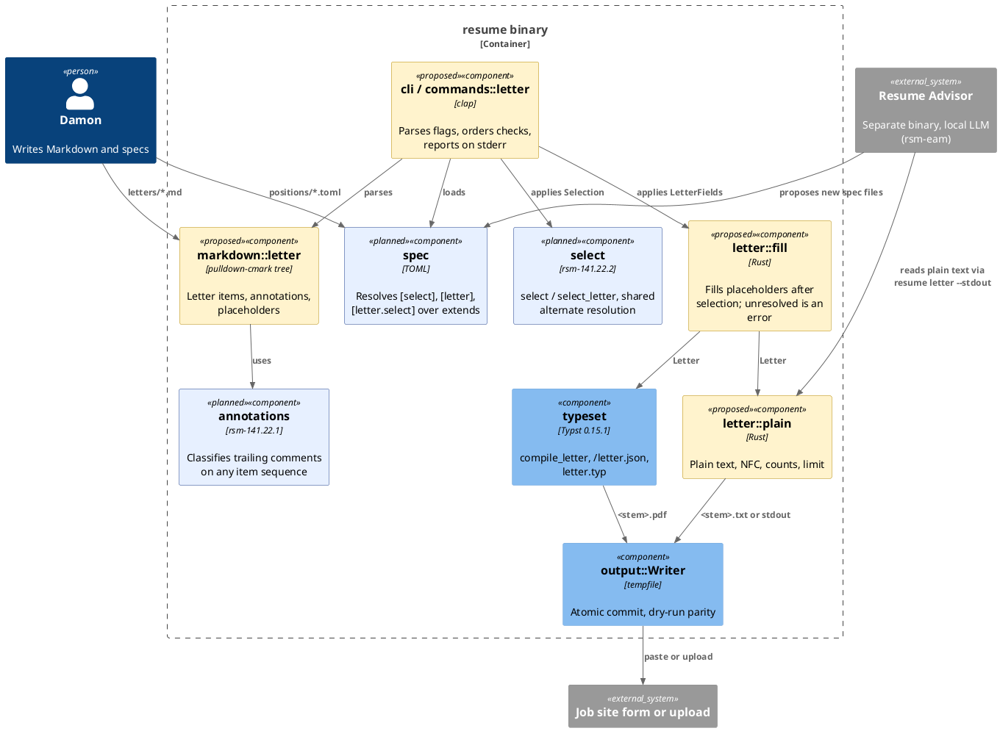
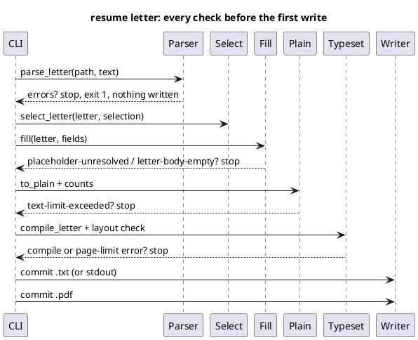

<!-- ABOUTME: Preserves the complete Oracle cover-letter research and review in order. -->
<!-- ABOUTME: Raw appendices are verbatim; the architecture document controls implementation. -->
# Cover letters: analysis and raw Oracle feedback

Captured 2026-11-20 UTC.
All three reports have STATUS: COMPLETE.
The initial report contains recommendations superseded by the planning pass and final synthesis.
See [Architecture and decisions](Cover-Letters-Architecture.md), [Implementation plan](Cover-Letters-Implementation-Plan.md), and [Test plan](Cover-Letters-Test-Plan.md).

## Consolidated findings

A separate letter model preserves resume compatibility; paragraph selection reuses tailoring semantics.
Explicit sections prevent frame ambiguity, and independent spec selection scopes prevent silent pick errors.
Plain text is the primary output; PDF reuses the sandbox and fonts without adding model dependencies.
The final review identified seven filing corrections, all adopted in the architecture decision record.

## Alternatives and remaining uncertainty

Rejected: letters embedded as resume sections, general template engines, sentence-level selection, shared picks validated across documents, automatic Unicode normalization, and inferred first/last paragraph frames.
Author-facing heading names, placeholder vocabulary and length-unit defaults remain recommendations to confirm with real letters/forms before release.
No implementation, rendered output, model evaluation or CI results are claimed by these reports.

## Raw appendix preservation

The following reports are copied byte-for-byte as UTF-8 text, in dispatch order.
Original headings, dates, wording, contradictions, code blocks and diagrams are retained.
The first report date differs from collection date; it has not been silently corrected.

## Appendix 1: cover-letter-oracle-architecture.md

# Cover-letter support: oracle architecture analysis

STATUS: COMPLETE

Date: 2026-11-19 (system clock; beads in this repo are dated 2026-11)

Functional intent: let the author write cover letters in Markdown next to the resume,
tailor them per application with the same tag/priority/selection machinery planned for resumes,
and emit both a plain-text version (to paste into website forms) and a styled PDF that matches the resume.

Questions:
1. What domain, parser, selection and output architecture supports authored cover letters
   with the planned priority/core, tags, draft/verify and alternate semantics,
   with first-class website plain text and styled PDF?
2. How should application position specs and the local-LLM Resume Advisor integrate cover letters
   without duplicating or breaking existing plans?

Scope: planning only. No code, Beads or git mutations. Detailed task breakdown deferred to a later dispatch.

## Part 1: Evidence (what is implemented versus planned)

Checked-out branch is `wip/rsm-141.18`, which does not contain `main` (`git merge-base --is-ancestor main HEAD` fails).
`main` (dee46ac) has the CLI from rsm-141.10, so all code evidence below was read with `git show main:<path>`.
Line numbers are from `main`.

Implemented on `main`:

- `src/model/mod.rs:14` `SCHEMA_VERSION = 1`; `:17-25` `Resume { schema, name, contact: Vec<Inline>, sections }`; `:50-55` `Block` (Paragraph, Bullets, Role, PageBreak); `:88-92` `Bullet { label, content }`; `:97-103` `Inline` (Text, Strong, Emph, Link, Code). No annotation fields exist yet.
- `src/model/text.rs:15-59` nutype text newtypes with `len_char_max` limits (Name 80, Company 120, Title 120, SectionTitle 60, EraName 80) and `LinkUrl` restricted to http, https and mailto (`:55-59`). Limits count Unicode scalar values, not graphemes or UTF-16 units.
- `src/markdown/mod.rs:45-95` `parse(path, text) -> Parsed`; `valid()` is `Some` only with no error diagnostics. `src/markdown/blocks.rs:21` `interpret(doc, src, sink) -> Option<Resume>` is resume-specific; `:134` `contact(...)` and `:172-210` comment classification are reusable pieces; `src/markdown/inline.rs:78-139` already drops inline comments and joins text around them. The tree phase (`tree.rs`) and `Sink`/`Finding` (`mod.rs:207-277`) are document-agnostic.
- `src/typeset/mod.rs:84-86` `Typesetter::compile(&Resume, &StyleSource, RenderOptions)` serializes the resume to JSON; `src/typeset/world.rs:21,46-56` serves it at the fixed virtual path `/resume.json` and passes `paper` via `sys.inputs`.
- `src/style.rs:275,312` every style has one entry file, `<name>/style.typ`; `styles/pragmatic/style.typ:7` reads `json("/resume.json")`; `styles/lib/components.typ:50` pins `schema-version = 1` and `:81-89` panics on an unknown inline kind, so adding an `Inline` variant is a breaking contract change for every style.
- `src/commands/build.rs:125-193` per-file pipeline: parse, stop without PDF on errors, compile, layout report, `export_pdf`, then `Writer::commit`. `src/output.rs:1-2,149-163` writes atomically via a temp file plus rename, with the same checks in a dry run.
- `src/commands/emit.rs:1-2` and `ref/Resume-RS-Architecture.md:508,768-769` (on `main`): human text and summaries on stderr; with `--format json`, stdout carries only JSON lines; operational errors are human lines on stderr.
- `src/cli.rs:43-52` commands are Build, Styles, ExportStyle, Licenses. There is no selection, spec, annotation, letter, or plain-text module anywhere on `main`.
- `ref/Resume-RS-Architecture.md:322` (on `main`): YAML front matter is off and `---` is not front matter.

Planned only (beads docs under `history/beads/`, all OPEN):

- `epic-tailoring.md` (rsm-141.22): trailing-comment annotations `@core|@extra`, `@draft|@verify`, `#tag`, `=group.variant`; selection `select(&Resume, &Selection) -> (Resume, SelectionReport)`; tags inherit downward, priority and status do not; untagged means general; alternates need a `default`, are adjacent in one container, and exactly one renders (pick, then preference list, then default); selection never adds, reorders or rewrites; annotations are `#[serde(skip)]` and schema 1 is unchanged.
- `task-tailoring-1-annotations.md`: `Annotations { priority, status, tags: BTreeSet<Tag>, alternate }` with `Tag`, `GroupName`, `VariantName` newtypes.
- `task-tailoring-2-selection.md`: `Selection { tags, core_only, drafts, prefer, pick }`; unknown picks reported.
- `epic-position-specs.md` (rsm-141.23): TOML `[position]`, `extends`, `[build] {content, style, paper}`, `[select] {tags, prefer, pick, promote, core-only}`; profiles hold `[select]` and `[build]` defaults, never `[position]`; merge: tags union, prefer specific-first, pick specific wins, scalars specific wins; `deny_unknown_fields`; spec metadata never enters the PDF; reordering is an open question.
- `task-specs-1-format.md`: `ResolvedSpec { position, content, style, paper, selection, chain }`.
- `epic-advisor.md` and `task-advisor-spike.md` (rsm-eam): separate binary, probably a separate repo; the spec format is the contract; local model by default; outputs a spec, an optional summary variant and a gap report; never edits content; generating content beyond a summary wording is out of scope.

Observation: `.gitignore` on `main` ignores `/history/` ("session working docs ... never commit"; the uncommitted user change only adds `_gsdata_/`).
So this file and the beads docs are local working records, not committed design.
Durable decisions belong in `ref/Resume-RS-Architecture.md` when implemented.

END OF PART 1

## Part 2: Verdict (Questions 1 and 2)

Purpose: Damon applies for jobs through websites that ask for a cover letter either as pasted text or as an uploaded PDF.
He wants each letter tailored to the posting, made from reusable, checked paragraphs, and matching the resume's look, without forking a letter per application or sending a letter with a leftover `{{company}}` in it.

Verdict, Question 1 (confidence: medium-high).
Add a second, deliberately small document kind, `Letter`, beside `Resume`, not a general document platform.
A letter is a flat, authored sequence of blocks: salutation, body paragraphs, closing, signature.
The selection unit is the whole paragraph, ordering is the author's and is never changed, and the existing planned annotation syntax and selection rules apply unchanged.
Per-application facts (company, title, recipient, date) enter through a closed set of placeholders, filled after selection and before any output, with an unresolved placeholder being an error.
Two outputs come from the same selected, filled model: a plain-text rendering with conservative character counts and an optional limit, and a PDF from a new optional `letter.typ` entry in a style, reading its own `/letter.json` contract.
The resume schema 1 and every existing style stay untouched.

Where I disagree with the prior discussion:

- Whole-paragraph selection and authored ordering: agreed, for the reasons in Part 3.
- Optional letter slots: not needed as a new concept.
  The per-application paragraph ("why this company") is an alternate of an ordinary group whose `default` is the generic wording.
  Where that text lives (baseline letter or a per-application file) is an owner decision in Part 7; slot syntax adds a second mechanism for the same thing.
- Per-document selections: needed, but as one refinement scope (`[letter.select]`) over a shared `[select]`, not two independent selections.
- Local-model review: belongs in the advisor (rsm-eam), outside the `resume` binary, consuming the plain-text output. It must not become a dependency of `resume`.

Verdict, Question 2 (confidence: medium).
Extend the planned spec with one optional `[letter]` table (content file, recipient, date, text limit) and an optional `[letter.select]` refinement.
Resolve `[select]` and `[letter.select]` each across the `extends` chain with the planned merge rules, then merge letter over shared.
Profiles may carry `[letter.select]` only.
The advisor stays a separate tool whose only writes are new files the owner reviews; any letter prose it proposes is marked `@draft`, so the existing status rule keeps it out of a sent letter until the owner removes the marker.

## Part 2a: Question 1, domain model (proposed, nothing implemented)

Proposed module `src/model/letter.rs`:

```rust
pub const LETTER_SCHEMA_VERSION: u32 = 1;

#[derive(Debug, Clone, PartialEq, Eq, Serialize)]
pub struct Letter {
    pub schema: u32,                  // LETTER_SCHEMA_VERSION
    pub kind: LetterKind,             // always "letter"; lets a style refuse resume.json by mistake
    pub name: Name,                   // sender, reuses model::text::Name
    pub contact: Vec<Inline>,         // same shape as Resume::contact, so the header component is shared
    pub date: Option<LetterDate>,     // from the spec only, never the clock (determinism)
    pub salutation: LetterBlock,
    pub body: Vec<LetterBlock>,       // non-empty after selection
    pub closing: LetterBlock,
    pub signature: Name,              // defaults to `name`
}

#[derive(Debug, Clone, PartialEq, Eq, Serialize)]
pub struct LetterBlock {
    pub content: Vec<Inline>,         // reuses model::Inline; no new inline kinds
    #[serde(skip)] pub annotations: Annotations,   // rsm-141.22.1 type, unchanged
    #[serde(skip)] pub placeholders: Vec<PlaceholderUse>,
}

#[derive(Debug, Clone, Copy, PartialEq, Eq, Hash, strum::EnumString, strum::Display, strum::VariantNames)]
#[strum(serialize_all = "kebab-case")]
pub enum Placeholder { Company, Title, Recipient }   // closed set; a typo is an error

pub struct PlaceholderUse { pub key: Placeholder, pub range: Range<usize> }  // source span for diagnostics

#[nutype(sanitize(with = collapse_whitespace), validate(not_empty, len_char_max = 120),
         derive(Debug, Clone, PartialEq, Eq, AsRef, Serialize))]
pub struct FieldValue(String);       // one line, no Markdown meaning

pub struct LetterFields { pub company: Option<FieldValue>, pub title: Option<FieldValue>,
                          pub recipient: Option<FieldValue>, pub date: Option<LetterDate> }
```

Decisions and why:

- `Letter` is a separate type, not `Resume` with a flag.
  A letter has no sections, roles, eras or bullets, and its positional parts (salutation, closing) have no resume equivalent.
  Reusing `Resume` would force every style and the resume selection to handle a shape that cannot occur.
- `Inline` is reused unchanged.
  `styles/lib/components.typ:81-89` panics on an unknown inline kind, so a new inline kind (for example a placeholder node) would break every style.
  Placeholders are therefore resolved in Rust into `Inline::Text` before any JSON exists, and Typst never sees one.
- Placeholder values are plain text inserted as `Inline::Text`, never re-parsed as Markdown.
  A company called `*Acme*` stays literal, and nothing from the spec can create a link or markup.
- `date` is a value from the spec.
  Reading the clock would break the planned byte-identical rebuild from a spec (`epic-position-specs.md` success criteria).
- Body blocks are paragraphs only in the first version.
  A bullet list inside a letter is an owner question (Part 7); the default is a diagnosed error with a hint, so support can be added later without changing meaning.

END OF PART 2

## Part 3: Question 1, Markdown format and parser

Proposed example, `letters/base.md`:

```markdown
# Damon Rolfs

Seattle, WA · [damon@example.com](mailto:damon@example.com) · [linkedin.com/in/dmrolfs](https://linkedin.com/in/dmrolfs)

Dear Hiring Team, <!-- =greeting.default -->

Dear {{recipient}}, <!-- =greeting.named -->

I am applying for the {{title}} role at {{company}}. <!-- =opening.default @core -->

I would like to bring my platform work to {{company}} as its {{title}}. <!-- =opening.short -->

At HERE I led the LLM gateway from design to production in one month. <!-- #ai #platform -->

I have run architecture reviews across forty teams. <!-- @extra #org -->

{{company}}'s move to Iceberg matches work I have done since 2019. <!-- @draft #data -->

I would welcome a conversation about the role. <!-- @core -->

Sincerely,
```

Structure rule (positional, over items).
An item is a paragraph or a whole alternate group.
After `# Name` and the contact paragraph (both parsed by the existing resume code, `src/markdown/blocks.rs:64,134`), the first item is the greeting, the last item is the closing, and every item between is the body.
The signature is the sender's name, so it is not written twice.

Why positional instead of fixed headings (`## Greeting`, `## Body`) or slot markers:
the source then reads as the letter itself, as the resume source reads as the resume (`epic-tailoring.md`, "the baseline still reads as one resume"), and no new marker syntax is needed.
The cost is that a P.S. or a second closing line is not expressible; that is acceptable for v1.

Annotation rules, reusing rsm-141.22.1 unchanged:

- Body items take every annotation: priority, status, tags, alternates.
- Greeting and closing take alternates only.
  Priority, status or tags on them is an error (`letter-frame-annotated`), because dropping either would produce a malformed letter.
- Tags do not inherit (a letter has no containers), so the planned rule "untagged means general" is the only rule that applies. This is consistent with the planned semantics, not an exception to them.
- An alternate group must still have `default` and adjacent variants, exactly as planned.
  An `@core` variant makes its group core, per the planned union rule.

Placeholders.
Syntax `{{key}}`, keys from the closed set `company`, `title`, `recipient`.
Allowed in text, strong and emphasis; an error inside code spans and inside link URLs, because the URL is validated at parse time (`src/model/text.rs:55-59`) and must not change afterwards.
There is no escape syntax in v1: any `{{` that does not form a known placeholder is an error with a did-you-mean hint.
Placeholders are recognised during the letter's inline lowering and recorded with their byte span, so later "unresolved" diagnostics point at the source.

The date is not a placeholder.
It is a structural field from the spec, rendered by the style where letters put it, so authors do not position it by hand.

Detection of document kind: by the command, never by sniffing.
`resume letter FILE` parses a letter; `resume build FILE` parses a resume.
A role line or a `##` heading inside a letter is a diagnosed error (`letter-unsupported-block`) with the hint "this looks like resume content", which catches a wrong-command mistake.

Parser module plan (proposed):

- `src/markdown/letter.rs`: `interpret_letter(doc, src, sink) -> Option<UnresolvedLetter>`, built on the existing tree phase, `Sink`, `Finding`, `inline` lowering, comment handling and the shared name and contact functions.
- `pub fn parse_letter(path, text) -> ParsedLetter` beside `parse`, with the same `valid()` invariant (no error implies a model, no model implies an error) and the same span checks at the one public exit (`src/markdown/mod.rs:95`, `ref/Resume-RS-Architecture.md:322`).
- The annotation recognizer from rsm-141.22.1 must be callable on a paragraph node regardless of document kind.
  This is the one shared-design requirement on rsm-141.22.1: its classifier and its alternate grouping must take "a sequence of items in one container" and not reach into `Section`/`Role` types.
  It should be stated in rsm-141.22.1's notes before that task starts.

## Part 3a: Question 1, diagnostics (proposed codes)

Errors (no output is produced):

| Code | When |
|---|---|
| `letter-too-short` | fewer than three items (greeting, at least one body item, closing) |
| `letter-frame-annotated` | priority, status or tag on the greeting or closing |
| `letter-frame-multiline` | greeting or closing longer than one line or over 120 characters |
| `letter-unsupported-block` | a heading other than the name, a list, a table, a quote, code, a page break, or a role line |
| `placeholder-unknown` | `{{compnay}}`, with did-you-mean |
| `placeholder-malformed` | `{{` without a closing `}}` on the same line, or with spaces or markup inside |
| `placeholder-position` | a placeholder in a code span or link URL |
| `placeholder-unresolved` | after selection, a kept block uses a key with no value; points at the use, names the spec key that would set it |
| `letter-body-empty` | selection kept no body item |
| `text-limit-exceeded` | the plain text exceeds the configured limit; reports the count, the unit and the excess |

Warnings:

| Code | When |
|---|---|
| `letter-verify` | a kept item is `@verify` (the planned status rule) |
| `variant-facts` | the planned numbers lint, unchanged |
| `field-value-markup` | a field value contains `*`, `_`, `` ` `` or `[`; it will be shown literally |
| `invisible-character` | a bidi control, zero-width or other format character (Unicode category Cf other than ZWJ inside an emoji sequence) in letter text or a field value; these change how pasted text displays |

`placeholder-unresolved` is reported only for kept blocks.
A placeholder inside a dropped paragraph or an unchosen variant is not an error, so a generic build of a letter whose named greeting uses `{{recipient}}` succeeds as long as the default greeting is chosen.
This is why resolution runs after selection, and it is the main ordering decision in the pipeline.

END OF PART 3

## Part 4: Question 1, selection, coherence and outputs

Selection (proposed `src/select/letter.rs`, beside the planned resume selection).

```rust
pub fn select_letter(letter: &UnresolvedLetter, selection: &Selection)
    -> (UnresolvedLetter, SelectionReport);
pub fn fill(letter: UnresolvedLetter, fields: &LetterFields)
    -> Result<Letter, Vec<Diagnostic>>;   // placeholder-unresolved, letter-body-empty
```

- `Selection` and `SelectionReport` are the rsm-141.22.2 types, unchanged.
  The same `--tags`, `--core-only`, `--prefer`, `--drafts` and `pick` meanings apply.
  The letter function is a second, much simpler walk (one flat list, no inheritance, no pruning of containers) and shares the alternate-resolution helper.
  Shared logic must be one function taking an iterator of items, so the resume and letter cannot drift apart on what "kept" means.
- Ordering: authored order, never changed. This matches the resume rule "selection never adds, reorders, or rewrites text" and makes the selected letter a subsequence of the source.
- Why whole paragraphs, not sentences: a letter paragraph is an argument; cutting sentences out of it produces broken transitions ("This also..." after its antecedent was removed) that no tool can check.
  Sentence-level variation is already available: write the paragraph twice as alternates.

Paragraph coherence.
Selection can still drop a paragraph that a later kept one refers to.
I recommend no dependency syntax (`requires=`) in v1, because it is a new graph feature for a problem an author can see in the output.
Instead:

- The summary lists kept and dropped body items in order, by their first words, so a gap is visible before sending.
- A warning `letter-dangling-opener` when a kept body item that directly follows a dropped one starts with a small closed list of back-referring openers (`Also`, `Additionally`, `This`, `That`, `These`, `Furthermore`, `In addition`, `As a result`).
  Cheap, deterministic, and wrong only in the safe direction (a warning).
  Whether to ship this lint is an owner choice; it is not required for correctness.

Placeholders in alternates: different variants of a group may use different keys; only the chosen one is checked.

### Plain-text output (`src/letter/plain.rs`, proposed)

`fn to_plain(letter: &Letter, links: LinkStyle) -> PlainLetter { text: String, counts: TextCounts }`

Rendering rules, all deterministic:

- Header: name, then contact items on one line joined by `" · "`, as in the source. Then date (if set), a blank line, recipient line (if set).
- Blocks separated by exactly one blank line; no hard wrapping (web forms reflow; a wrapped paste shows ragged breaks).
- Inline: strong and emphasis lose their markers; code keeps its text without backticks.
- Links: `LinkStyle::TextAndUrl` (default) renders `text (https://...)`, collapsing to just the URL when the text equals the URL without scheme; `mailto:` renders the address only. `LinkStyle::TextOnly` is for forms that reject URLs. Never Markdown link syntax.
- Normalization: output is NFC (requires `unicode-normalization`, a new dependency; owner decision) and LF line endings with one trailing newline; smart punctuation from the parser is kept (curly quotes, en dash). An `--ascii` transliteration is not proposed; it is unrelated scope.
- Signature: closing line, then the name on the next line.

Unicode counts and limits.
Forms count differently: HTML `maxlength` counts UTF-16 code units, many back ends count Unicode scalar values, and some count bytes.
`TextCounts { scalars, utf16_units, utf8_bytes, words }` reports all four, computed on the exact emitted string including newlines (CRLF is not counted, since form submission normalizes newlines to CRLF; that adds one unit per line break and is called out in the summary).
The limit is `max = N` with `unit = "utf16" | "chars" | "bytes"`, default unit `utf16`, the strictest of the common cases for text with emoji or astral characters.
Exceeding it is the error `text-limit-exceeded`, before any file is written; there is no automatic truncation, because truncating a letter silently is worse than refusing.
Graphemes are not offered: no form counts them, and they would need another dependency.

### PDF output

- New optional style entry `<style>/letter.typ`, beside `style.typ` (`src/style.rs:275,312`), reading `json("/letter.json")`.
  A style without `letter.typ` is refused with a clear error naming the style, and `resume styles` gains a "letter" column.
- `ResumeWorld` is generalized to serve one document at its virtual path: `/resume.json` for resumes (unchanged), `/letter.json` for letters. Paper still comes through `sys.inputs`.
- `Typesetter::compile_letter(&Letter, &StyleSource, RenderOptions)` beside `compile`, sharing the world, fonts and isolation (`src/typeset/mod.rs:84-86,181`).
- `styles/lib/components.typ` gains `letter-schema-version = 1` and the letter checks a `kind == "letter"` field, so feeding the wrong JSON to a style fails loudly, matching the existing "an unknown kind stops the render" rule (`components.typ:81`).
- Only `pragmatic` gets a `letter.typ` in v1, sharing its header, fonts and colors through `theme.typ` and `components.typ`. One page is the norm: the layout report's `--max-pages` applies, with a default of 1 for letters.
- PDF metadata title is "Cover letter, <name>". No company, title, tag, profile or spec path enters PDF metadata; this extends the planned rsm-141.23.2 test "the PDF contains no spec metadata".
  The company does appear in the body text, by intent.

Correction to the metadata bullet above: `styles/pragmatic/style.typ` sets no `document` title today (grep found none), and `src/typeset/pdf.rs:14-21` exports with no timestamp and a caller-supplied `ident`, which `build` takes from the input file stem (`src/commands/build.rs:171`).
So the rule for letters is: the PDF `ident` comes from the letter file stem, never from the spec or company, and the letter style sets no title or keywords containing position data.
A test asserts the PDF's metadata and ident contain no field value.

END OF PART 4

## Part 5: Question 1, CLI, output safety, compatibility, tests

CLI (proposed; additive to `src/cli.rs:43-52`).

```
resume letter FILE [--out DIR] [--format-out pdf|text|both] [--stdout]
              [--style NAME] [--styles-dir DIR] [--paper P] [--max-pages N]
              [--company S] [--title S] [--recipient S] [--date YYYY-MM-DD]
              [--max-chars N --count-unit utf16|chars|bytes] [--links text-and-url|text-only]
              [--tags ..] [--core-only] [--prefer ..] [--drafts]   # only once rsm-141.22.3 lands
resume letter --spec positions/acme.toml                              # only once rsm-141.23.2 lands
```

A separate subcommand, not `build --letter`, because the input kind, the outputs and the field flags differ, and clap then rejects resume-only flags on a letter instead of ignoring them.
The selection flags are the same `Args` struct flattened into both commands, so their meaning cannot drift.

Stream rules, extending `ref/Resume-RS-Architecture.md:768-769` without changing them:

- Files: `<stem>.pdf` and `<stem>.txt` in `--out`, through `Writer::commit` (`src/output.rs:84-163`), so atomic writes and `--dry-run` parity are inherited.
- `--stdout` prints the plain text to stdout and writes no `.txt`. It conflicts with `--format json`, because stdout is reserved for JSON lines in that mode (a usage error, exit 2). Diagnostics and the summary stay on stderr, so `resume letter x.md --stdout | pbcopy` copies only the letter.
- The summary line on stderr adds the counts: `letter: 1 page, 1,742 chars (1,748 UTF-16 units, 291 words), limit 2,000`.

Failure before write.
The order is: parse, select, fill, plain render, count and limit check, PDF compile and layout check, then commit both files.
Every check that can fail runs before the first commit, so a too-long letter or an unresolved placeholder never leaves a stale `.txt` beside a fresh `.pdf`.
Commit order is text then PDF; a failure on the second commit (disk full, locked file) is reported, and the first file remains valid on its own.
Two-file atomicity is not attempted; the existing writer is per-file and that is enough.

Privacy.

- Letters and specs contain the employer's name, which is sensitive while a search is private.
  Nothing letter-related is written outside `--out`; no cache, no log file.
- The JSON diagnostics and summary may contain the company name in messages; that is local output, but `--format json` consumers should be told in the guide.
- No network access in `resume`, unchanged. The advisor has its own rules (Part 6).
- Suggest in the guide that `positions/` and `letters/` live in a private repo. Not enforced.

Compatibility strategy.

- Resume JSON schema 1, `/resume.json`, every existing style and the `build` command: unchanged.
  The letter contract is a separate schema with its own version, so neither can force a bump of the other.
- Style directories without `letter.typ` keep working for resumes; only `resume letter` refuses them, with a hint.
- `resume export` (planned) gains a letter mode later, writing `letter.json` for style development; not in v1.
- The annotation, selection and spec plans are extended, not replaced: the only change requested of the open tasks is the item-sequence boundary in rsm-141.22.1 (Part 3) and the alternate-resolution helper in rsm-141.22.2 being callable on a flat list.

Implementation can start before tailoring lands.
Phase A (no dependency on rsm-141.22 or .23): letter model, parser without annotations (every paragraph kept), placeholders via flags, plain text, counts, limits, PDF.
Phase B (after rsm-141.22.2): annotations and selection on letters.
Phase C (after rsm-141.23.1): `[letter]` in specs.
Phase A is useful on its own, because one generic letter with three fields already covers many applications.
The ordering is a recommendation for the next planning dispatch, not a task list.

Tests (to be expanded into a test plan later).

- Parser: each item position; positional greeting/body/closing; every diagnostic code with span; comments still dropped; annotations stripped leave identical text (property, reusing the rsm-141.22.1 property).
- Placeholders: each key; unknown, malformed, code-span and URL positions; unresolved only for kept blocks; values with Markdown characters stay literal; values never create links.
- Selection (property tests): output body is a subsequence of input; exactly one variant per kept group; every `@core` item survives; `@draft` absent unless drafts; greeting and closing always present; idempotent.
- Plain text: golden files; link styles; NFC; one trailing newline; LF only; counts checked against independent computation (`str::chars().count()`, `encode_utf16().count()`, `len()`) on fixtures with emoji, combining marks, CJK and a ZWJ sequence; limit boundary at N and N+1 per unit.
- Output safety: an over-limit or unresolved letter writes nothing (`leftovers` style checks as in `src/output.rs` tests); `--stdout` with `--format json` is exit 2; `--dry-run` writes nothing and reports both targets.
- PDF: renders one page for the fixture; text extraction contains every kept paragraph and no dropped one; byte-identical across two builds; metadata and ident contain no field value; a style without `letter.typ` fails with the expected error; `letter.typ` refuses `resume.json` (kind check).

### Component diagram (recommended design; proposed elements marked)

No PlantUML convention was found in `ref/` on `main` (not searched exhaustively), so this uses the plain C4 library defaults.





END OF PART 5

## Part 6: Question 2, position specs and the advisor

### Proposed spec shape (extends the planned rsm-141.23 shape; additions marked)

```toml
# positions/2026-11-acme-principal-ai.toml
extends = ["principal", "ai-platform"]

[position]                       # planned, unchanged; the letter reads company and title from here
company = "Acme"
title = "Principal Architect, AI Platform"
level = "principal"
audience = "technical"
posting = "https://example.com/jobs/123"

[build]                          # planned, unchanged: the resume
content = "../baselines/baseline.md"
style = "pragmatic"
paper = "letter"

[select]                         # planned, unchanged: shared by resume and letter
tags = ["iceberg"]
prefer = ["short"]
pick = { gateway = "long" }

[letter]                         # NEW, optional; its presence means "this application has a letter"
content = "../letters/base.md"   # relative to this file
recipient = "Dr. Jane Smith"     # optional; fills {{recipient}}
date = 2026-11-21                # optional TOML date; never the clock
style = "pragmatic"              # optional; defaults to [build].style
outputs = ["pdf", "text"]        # optional; default both
text-limit = { max = 2000, unit = "utf16" }   # optional; no limit by default
links = "text-and-url"           # optional

[letter.select]                  # NEW, optional; refines [select] for the letter only
tags = ["data"]
prefer = ["named"]
pick = { opening = "acme" }
core-only = false
```

Rules:

- `{{company}}` and `{{title}}` come from `[position].company` and `[position].title`.
  No second copy under `[letter]`, so the resume spec and the letter cannot disagree on the employer's name.
  Values are validated as `FieldValue` at load time, so an over-long or empty company is a spec error naming the key.
- `deny_unknown_fields` applies to `[letter]` and `[letter.select]` as planned for the rest.
- A spec with no `[letter]` behaves exactly as planned; `resume letter --spec` on it is an error ("this spec has no [letter] table").
- `resume build --spec` ignores `[letter]`; `resume letter --spec` ignores `[build].content`. Neither command builds both.
  A combined "build the application" command is a convenience that can come later; it is not needed for correctness and would couple the two failure paths.

### Scoped selection inheritance

Two scopes, shared and letter, each resolved over the `extends` chain with the planned rules (tags union, prefer specific first, pick specific wins, scalars specific wins).
Then the effective letter selection is the merge of letter scope over shared scope with the same rules: letter-scope is treated as more specific than shared.

```
effective_letter = merge(resolve_chain(select), resolve_chain(letter.select))
effective_resume = resolve_chain(select)          # unchanged from the plan
```

Why this shape:

- A tag such as `#ai` means the same thing in both documents, so the shared scope avoids writing it twice.
- Letter-only needs are real (a `named` greeting preference, a per-company opening pick) and must not leak into the resume, where `prefer = ["named"]` would be harmless but `pick = { opening = ... }` names a group the resume lacks.
- Group namespaces are per document.
  A shared `pick` naming a group that exists in only one document is reported as unknown only if it exists in neither, otherwise it is silently applicable to the one that has it.
  This is the one place I relax the planned "unknown pick is reported" rule, and it is an owner decision (Part 7); the stricter alternative is to forbid `pick` in shared `[select]` and require it per scope.
- No subtraction (`tags-remove`) is offered, keeping the planned monotone merge. A letter that needs fewer tags than the resume uses `core-only` or explicit picks.

Profiles: may contain `[letter.select]` (reusable, for example "technical-audience prefers the technical opening"), and must not contain `[letter]`, by the same reasoning as the planned "no `[position]` in a profile": content, recipient and date belong to one application.
Resolved type (proposed, extends the planned one):

```rust
pub struct ResolvedSpec { position, content, style, paper, selection, chain,  // planned
                          letter: Option<ResolvedLetter> }                       // new
pub struct ResolvedLetter { content: PathBuf, style: StyleName, paper: Paper,
                            fields: LetterFields, selection: Selection,
                            outputs: BTreeSet<LetterOutput>, text_limit: Option<TextLimit>,
                            links: LinkStyle }
```

The resolved-spec printing planned in rsm-141.23.2 prints `[letter]` and the effective letter selection too.

### Advisor boundary (rsm-eam)

Keep the planned boundary: a separate binary, local model by default, that only writes new files for review, with the spec format as the contract.
Cover letters add three things, all inside that boundary:

1. Input. The advisor reads the letter source (the annotated Markdown) and, for review, the plain text produced by `resume letter --stdout`. It never parses Markdown itself for review, so it reviews exactly what would be sent.
2. Proposals. It may propose `[letter]` and `[letter.select]` in the spec file it already writes, and an optional proposed paragraph as a new alternate written to a separate file (`proposals/<spec-stem>.letter.md`) with `@draft` on it. The owner copies it into the letter by hand. The `@draft` rule then keeps it out of a sent letter until the marker is removed, which is the existing planned guard, not a new one.
3. Review report. Given the plain text and the posting, a report of claims in the letter that are not supported by the baseline resume, requirements of the posting not addressed, and tone flags. A report, never an edit.

This expands the epic's out-of-scope line "generating resume content beyond a proposed summary wording" to letter paragraphs. That is a scope change the owner must approve; the default should be review-only, with paragraph proposals as a second step after the spike shows the review is useful.

Privacy for the advisor: a letter carries the employer's name in addition to the resume content, so the existing "local by default, online only by explicit opt-in" rule applies to every letter input, including the plain text.

The spike (rsm-eam.1) should add one posting's letter review to its measured cases rather than becoming a separate spike.

END OF PART 6

## Part 7: Options considered, recommendation, decisions for the owner

### Options

Option 1: Letter as a resume section (`## Cover Letter` inside the baseline).
Fit: poor. It mixes two documents in one model and schema, forces every style to skip it, and makes `--max-pages` meaningless. Fails for a separate PDF upload.

Option 2: A general document platform (typed front matter, document kinds, plugin layouts).
Fit: over-scoped. Front matter is deliberately off (`ref/Resume-RS-Architecture.md:322`), and nothing beyond resume plus letter is requested.

Option 3 (recommended): A small `Letter` kind with its own parser entry, schema and style entry, reusing tree, inline, annotations, selection, writer and typesetter.
Cost: one model file, one parser module, one selection walk, a plain renderer, one Typst entry per style that wants letters, one subcommand.
Fails when: letters need structure beyond paragraphs (lists, P.S., multiple signatures); then the block type grows, which the positional rule allows.

Option 4: Template engine (Tera, Handlebars) over a free-form letter.
Fit: poor. Conditionals in the text duplicate the selection rules with different semantics, and a template language is a new user-facing syntax with weaker diagnostics.

Option 5: Sentence-level selection.
Rejected on coherence (Part 4).

### Recommendation

Option 3, built in the phase order of Part 5 (A: letter without selection; B: selection; C: spec).
Smallest correct first step: the `Letter` model, `parse_letter` without annotations, placeholders from CLI flags, the plain-text renderer with counts, and the limit check, with every check before any write.
That step needs no open task to land and fixes the formats that later phases build on.
The PDF follows in the same phase but is separable if Typst work should wait for rsm-141.18.

### Decisions needing owner attention

1. Placeholders at all (recommended yes, closed set `company`, `title`, `recipient`), and whether the closed set is enough. Confidence high that a closed set is right; medium on the three names.
2. Where per-application paragraphs live: as an alternate in the shared letter (recommended, consistent with "alternates replace a free-text override" in `epic-tailoring.md`), or in a per-application letter file that the spec names. The first keeps one source; the second keeps private one-off text out of the shared letter. Medium.
3. A shared `pick` naming a group in only one document: applicable to the one that has it (proposed), or `pick` forbidden in shared `[select]`. Medium.
4. Lists inside letter bodies: error in v1 (proposed) or allowed. Medium.
5. The `letter-dangling-opener` lint: ship or skip. Low stakes.
6. Default count unit `utf16` and adding `unicode-normalization` for NFC. Medium; the alternative is no normalization and a warning on non-NFC input.
7. Advisor scope: review-only first (proposed), paragraph proposals later, which amends rsm-eam's out-of-scope line.
8. Date: spec or flag only, never the clock (proposed; required for reproducible rebuilds).
9. Change request to rsm-141.22.1 and .22.2: annotation classification and alternate resolution must work on a flat item sequence. Cheap now, a refactor later.

## Risks and unknowns

- Evidence was read from `main` (dee46ac) via `git show`, not from the checked-out `wip/rsm-141.18`, which lacks `main`. If rsm-141.18 changes `typeset/world.rs` or the style entry rules, Part 4's PDF section needs a re-check. Confidence the reuse points exist: high.
- I did not open `ref/Resume-RS-Architecture.md` in full, `src/markdown/tree.rs`, or the lint module; claims about reusing the tree phase rest on `src/markdown/mod.rs:1-8` and the function list of `blocks.rs`. Medium.
- No PlantUML convention was checked beyond `ref/` file names; diagrams use library defaults.
- No graph corpus was queried; grep and direct reads only.
- The positional greeting/closing rule is unproven against real letters; one sample from the owner would settle it.
- Web-form count behaviour (UTF-16 `maxlength`, CRLF on submit) is from general knowledge of HTML, not verified in this session.
- `history/` is in `.gitignore` on `main`, so this analysis is local only. Decisions that are accepted should move to `ref/Resume-RS-Architecture.md` and the beads.
- No dispatch-given librarian briefing; no second root.

## Not analyzed (over the scope cap)

Nothing beyond the two questions was asked. The detailed task breakdown is deferred to the next dispatch, as requested.

THIS IS THE FINAL PART.


## Appendix 2: cover-letter-oracle-plan.md

# Cover letter: implementable contract and epic/task plan (oracle)

STATUS: COMPLETE

Capture date: 2026-11-20 UTC (dispatch-stated).
Follows `history/cover-letter-oracle-architecture.md`, which carries its own earlier date; that file is preserved unchanged and this one supersedes it where stated.
Evidence base: `main` at `dee46ac` read via `git show main:<path>`; the working branch `wip/rsm-141.18` lacks main and was not changed.

Functional intent: let the user produce a tailored cover letter from the same source repository as the resume, selected by the same profile, as plain text for web application forms by default and as a styled PDF on request.

Questions:
1. Resolve the listed design inconsistencies into one implementable contract (types, grammar, examples), superseding earlier recommendations explicitly.
2. Decompose into epics and tasks with dependencies on the real open rsm-141.22, rsm-141.23 and advisor (eam) tasks, a file map, a test/acceptance matrix, estimates and release gates.

All defaults below are recommendations, not owner approvals.

## Part 1: Verdict and what this supersedes

Purpose: Damon pastes cover letters into job-site text boxes and sometimes uploads a PDF.
He wants each letter built from reusable, checked paragraphs, chosen by the same profiles as the resume, with no leftover `{{company}}` and no paragraph he marked as unready slipping through.

Verdict (confidence: medium-high).
Build cover letters as two epics.
E1, the deterministic letter core, needs no open task: explicit letter sections, closed placeholders, plain text to stdout by default, an opt-in PDF, and an error on any annotation-shaped comment so nothing is silently dropped.
E2 adds annotations, selection and specs on top of rsm-141.22 and rsm-141.23, reusing their code rather than copying it.
Letter selection comes only from `[letter.select]` along the same profile chain; the resume's `[select]` is unchanged and never read by a letter.
Letter review by a model is a separate spike under rsm-eam, not part of either epic and not a widening of rsm-eam.1.

### Superseded recommendations from `cover-letter-oracle-architecture.md`

That file stays as written. Where the two disagree, this file wins.

| Earlier position (part) | Replaced by | Why |
|---|---|---|
| Positional structure: first item greeting, last item closing (3) | Fixed `## Greeting`, `## Body`, `## Closing` sections (Part 2) | Positional rules break when an alternate group or a dropped paragraph sits at an edge, and conflict with "greeting is one block" once groups exist |
| `Letter` holds `LetterBlock { content: Vec<Inline>, placeholders: Vec<PlaceholderUse> }` before and after selection (2a) | Three stages: `LetterSource` (pieces with placeholders), `SelectedLetter`, resolved `Letter` with `model::Inline` only (Part 2) | Placeholder locations must survive selection; mixing them into `model::Inline` would touch schema 1 |
| Shared `[select]` applies to letters, merged under `[letter.select]`; unknown shared picks tolerated (6, decision 3) | `[select]` is resume-only and unchanged; letters read `[letter.select]` only (Part 4) | Keeps rsm-141.22.2's "unknown pick is reported" rule exact, and never needs the resume to check a letter pick |
| Phase A: parser without annotations, "every paragraph kept" (5) | E1 reports `letter-annotation-unsupported` for annotation-shaped comments (Part 2) | Otherwise `<!-- @draft -->` is dropped and a draft is sent |
| Plain text includes the postal header: name, contact, date, recipient (4) | Plain text is greeting, body, closing, signature only (Part 3) | That is what a web form wants; the PDF keeps the styled header |
| NFC output with `unicode-normalization` (4, decision 6) | No normalization beyond line endings; no new dependency (Part 3) | Nothing showed NFC was needed; rewriting user text is a surprise |
| Count units `utf16 | chars | bytes`; summary with CRLF caveat (4) | Units `utf16 | scalars | bytes`, words by `split_whitespace`, a `line-breaks` count (Part 3) | "chars" is ambiguous; line breaks let the user adjust for CRLF |
| `--format-out pdf|text|both`, default both, `--stdout` flag (5, 6) | `--output-format text|pdf|both`, default `text`, text always on stdout, printed last (Part 3) | Avoids clashing with global `--format`; text-only must not need Typst |
| `field-value-markup` and `invisible-character` warnings (3a) | Dropped | Unrequested heuristics; values are inserted literally anyway |
| `letter-dangling-opener` warning (4, decision 5) | Dropped; body must be non-empty; coherence is a documented human review step | A word-list lint is a guess dressed as a check |
| `letter-too-short`, `letter-frame-multiline` (3a) | Replaced by section-shape errors (Part 2) | Sections make these counts structural |
| Advisor may propose `@draft` paragraphs; spike rsm-eam.1 absorbs letter review (6) | New spike rsm-eam.2 (proposed): review report and `[letter.select]` proposals only; generated prose is a gated follow-on (Part 6) | rsm-eam.1 is already scoped; prose was not requested |

Kept unchanged: a separate `Letter` kind and schema; `Inline` and resume schema 1 untouched; whole-paragraph selection in authored order; closed placeholder set filled after selection; date from spec or flag, never the clock; optional `letter.typ` per style; every check before the first write; `resume letter` as its own subcommand.

### Evidence checked for this plan (all on `main` at `dee46ac` via `git show`)

- `src/cli.rs:25-31`: `--format` is a global flag of type `OutputFormat { Human, Json }` (`src/model/options.rs:29-33`). A letter flag named `--format-out` or `--format` would collide in meaning or name; hence `--output-format` with its own type.
- `src/commands/build.rs:84-96`: `Job::prepare` resolves the style and builds the font set before any file is read. A letter command copying this would fail text-only runs on a missing `letter.typ`; the letter job must prepare Typst lazily.
- `src/commands/build.rs:166-178`: PDF export then `Writer::commit`; `src/output.rs:36,64,84` `Planned`, `Writer`, `commit` are reusable as is.
- `ref/Resume-RS-Architecture.md:768-769`: with `--format json` stdout holds only JSON lines; operational errors are human lines on stderr.
- `ref/Resume-RS-Architecture.md:322` and `src/markdown/tree.rs:257`: smart punctuation on, front matter off, CRLF and lone CR accepted with spans into the original text.
- `src/markdown/blocks.rs:172-206` `classify_html` and `src/markdown/inline.rs:124-128` `is_comment`: comments are classified and dropped today, in two places. The annotation-shape predicate needs one home.
- `src/markdown/mod.rs:48-95`: `Parsed` with `valid()` only when no error; `parse` runs edit-safety checks at the one exit.
- `src/diagnostics/code.rs:8-60`: `DiagnosticCode` is one kebab-case enum with categories; letter codes join it.
- `Cargo.toml` `[dependencies]`: `time` (with serde) is present, so `LetterDate` needs no new crate; `unused_dependencies = "deny"` makes adding a crate a visible decision.
- `tests/dependencies_test.rs:23-50`: Typst pinned `=0.15.1`, no network crates; letters change neither.
- `justfile:42,59,176`: `test`, `check` (fmt, clippy, unused-deps, test) and `verify` are the gates to cite.
- Beads (`bd show`): rsm-141.22.1, .22.2, .22.3, .23.1, .23.2, rsm-eam.1 are all OPEN. rsm-141.22.2 says "per-group picks naming an unknown group or variant are reported, not silently ignored". rsm-141.23.1 is blocked by .22.2 and blocks rsm-eam; rsm-eam.1 is blocked by .23.1.
- `history/beads/epic-tailoring.md:44`: a comment is an annotation when its first token starts with `@`, `#`, or `=`. E1 reserves exactly that shape.

END OF PART 1

## Part 2: Contract, Markdown format and models (Question 1)

### Source format

A letter file has the resume's header, then exactly three level-2 sections in this order.

```markdown
# Damon Rolfs

Seattle, WA · [damon@example.com](mailto:damon@example.com)

## Greeting

Dear Hiring Team,

## Body

I am applying for the {{title}} role at {{company}}.

At HERE I led the LLM gateway from design to production in one month.

I would welcome a conversation about the role.

## Closing

Sincerely,
```

Grammar (E1):

```
letter    = name-h1 contact-para? greeting body closing
greeting  = "## Greeting" item          ; exactly one paragraph
body      = "## Body" item+             ; one or more paragraphs
closing   = "## Closing" item           ; exactly one paragraph
item      = paragraph                   ; E2 adds: | alternate-group
```

- Section titles match exactly, case-sensitive, in English. They are structure, not text, and never appear in output.
- The signature is the `# Name`. It is not written twice.
- Header parsing reuses `blocks.rs` name and contact handling and its existing codes (`missing-name`, `duplicate-name`, `missing-contact`, `invalid-link`, `text-too-long`, ...).
- Comments that are not annotation-shaped are dropped, as in resumes.

Why explicit sections and not positions: with alternate groups (E2), "first item" is ambiguous when the first item is a group, and a section boundary is the only way a greeting group and a body group can sit next to each other without merging.
The cost is three heading lines, which readers of the raw file find obvious.
Confidence high.

### The annotation reservation (E1 only)

In E1, any HTML comment anywhere in a letter whose first token starts with `@`, `#`, or `=` (the shape fixed in `epic-tailoring.md:44`) is the error `letter-annotation-unsupported`, with the hint "letter annotations arrive with tailoring (rsm-141.22); remove the comment to build now".
So `<!-- @draft -->` can never be silently dropped and the paragraph sent.
E2 replaces this error with real recognition; nothing else changes, so letters written for E1 stay valid.
The predicate "is annotation-shaped" must be one function, shared with rsm-141.22.1's classifier (it lives beside `classify_html`, `src/markdown/blocks.rs:172`), so the reservation and the later parser cannot disagree.

### Diagnostic codes (new, all errors)

| Code | When |
|---|---|
| `letter-missing-section` | `## Greeting`, `## Body`, or `## Closing` is absent; names which |
| `letter-unknown-section` | any other `##` title; did-you-mean among the three |
| `letter-duplicate-section` | a section appears twice |
| `letter-section-order` | sections out of order |
| `letter-section-shape` | greeting or closing is not exactly one item; body has none |
| `letter-unsupported-block` | list, table, quote, code block, `###` or deeper heading, page break, footnote; hint for a role line: "this looks like resume content" |
| `letter-annotation-unsupported` | E1 only, as above |
| `letter-frame-annotated` | E2: priority, status or tag on a greeting or closing item, or any annotation on a section heading |
| `letter-body-empty` | E2: selection kept no body item |
| `placeholder-unknown` | `{{compnay}}`; did-you-mean |
| `placeholder-malformed` | `{{` not followed by `key}}` with no spaces; hint shows `{{company}}` |
| `placeholder-position` | a placeholder in a code span |
| `placeholder-unresolved` | after selection, a kept item uses a key with no value; names the flag and spec key |
| `text-limit-exceeded` | plain text over the limit; count, unit and excess |

Content before `## Greeting` other than the header reuses `content-before-section`.
No new warnings.
No Unicode, markup-in-value, or dangling-opener lints.

### Placeholders

```
placeholder = "{{" key "}}"
key         = "company" | "title" | "recipient"
```

- Recognized in text, strong, emphasis and link text, scanning each run of adjacent text after inline lowering, so `{{company}}’s` works with smart punctuation on.
- Not recognized in URLs: a URL is validated at parse time and never changes. `{{` inside a URL is left to the existing link checks.
- No escape syntax. Any `{{` is a placeholder attempt. A lone `{` or `}}` is literal.
- `date` is not a placeholder. It is a field the PDF style places.

### Models

Three stages, each its own type in a new `src/letter/` module.
None touches `model::Inline`, `Resume`, or schema 1.

```rust
// src/letter/source.rs: parser output, before selection
pub struct LetterSource {
    pub name: Name,                       // model::text::Name
    pub contact: Vec<Inline>,             // model::Inline, as Resume::contact
    pub greeting: Piece,                  // E2: Item
    pub body: Vec<Piece>,                 // non-empty; E2: Vec<Item>
    pub closing: Piece,                   // E2: Item
}
pub struct Piece {
    pub content: Vec<LetterInline>,
    pub range: Range<usize>,              // whole paragraph, for diagnostics and the summary
}
pub enum LetterInline {
    Text(String),
    Strong(Vec<LetterInline>),
    Emph(Vec<LetterInline>),
    Link { url: LinkUrl, children: Vec<LetterInline> },
    Code(String),
    Placeholder { key: Placeholder, range: Range<usize> },   // byte span of `{{key}}`
}
#[derive(Clone, Copy, PartialEq, Eq, Hash, Debug, strum::EnumString, strum::Display, strum::VariantNames)]
#[strum(serialize_all = "kebab-case")]
pub enum Placeholder { Company, Title, Recipient }
```

E2 adds, using rsm-141.22.1's types and grouping:

```rust
pub enum Item { One(Annotated<Piece>), Group(AlternateGroup<Piece>) }
```

`Annotated` and `AlternateGroup` are whatever rsm-141.22.1 names its generic "annotated thing" and "adjacent variants" shapes.
That task must make them generic over the item, or a letter copies them. That is the one requested change to it (Part 5).

```rust
// src/letter/select.rs (E2); E1 passes LetterSource through unchanged
pub struct SelectedLetter { /* same fields as LetterSource, every Item reduced to one Piece */ }

// src/letter/resolve.rs
pub struct LetterFields {
    pub company: Option<FieldValue>, pub title: Option<FieldValue>,
    pub recipient: Option<FieldValue>, pub date: Option<LetterDate>,
}
pub fn resolve(selected: SelectedLetter, fields: &LetterFields) -> Result<Letter, Vec<Diagnostic>>;

// src/letter/model.rs: resolved, serialized to /letter.json
pub const LETTER_SCHEMA_VERSION: u32 = 1;
#[derive(Serialize)]
pub struct Letter {
    pub schema: u32, pub kind: LetterKind,          // kind serializes as "letter"
    pub name: Name, pub contact: Vec<Inline>,
    pub date: Option<LetterDate>,                   // ISO "2026-11-21"; the style formats it
    pub recipient: Option<FieldValue>, pub company: Option<FieldValue>,   // PDF address block
    pub greeting: Vec<Inline>, pub body: Vec<Vec<Inline>>, pub closing: Vec<Inline>,
}
```

- `resolve` maps `LetterInline` to `model::Inline`, replacing each placeholder with `Inline::Text(value)` and merging adjacent text. Values are never parsed, so `*Acme*` stays literal and cannot form a link.
- It reports every unresolved placeholder at once, at its source span, only for pieces that survived selection.
- `FieldValue`: nutype over `String`, trimmed, not empty, at most 120 Unicode scalars, no control characters (category Cc, which includes line breaks). No other rewriting.
- `LetterDate`: newtype over `time::Date` (already a dependency), parsed from `YYYY-MM-DD`. Never read from the clock.
- `Letter` has no annotation or placeholder fields, so the JSON contract cannot leak them.

END OF PART 2

## Part 3: Contract, outputs and CLI (Question 1, continued)

### Plain text (`src/letter/plain.rs`)

```rust
pub fn to_plain(letter: &Letter, links: LinkStyle) -> PlainLetter;
pub struct PlainLetter { pub text: String, pub counts: TextCounts }
pub struct TextCounts { pub utf16: usize, pub scalars: usize, pub bytes: usize,
                        pub words: usize, pub line_breaks: usize }
pub enum LinkStyle { TextAndUrl, TextOnly }          // default TextAndUrl
```

Layout, exactly:

```
<greeting>\n\n<body 1>\n\n...<body n>\n\n<closing>\n<name>\n
```

Example, from the Part 2 source with `--company Acme --title "Principal Architect"`:

```
Dear Hiring Team,

I am applying for the Principal Architect role at Acme.

At HERE I led the LLM gateway from design to production in one month.

I would welcome a conversation about the role.

Sincerely,
Damon Rolfs
```

- No name heading, contact line, date, recipient or address block. Web forms already have those fields.
- No hard wrapping. A soft break in the source becomes one space; a paragraph is one line.
- Strong and emphasis drop their markers. Code keeps its text, no backticks.
- Links: `TextAndUrl` gives `text (https://...)`, or only the URL when the text equals the URL with the scheme removed; `mailto:` gives the address. `TextOnly` gives the text. Never Markdown syntax.
- Unicode: the text is the user's, unchanged. The only normalization is line endings: the output uses LF, ends with exactly one LF. Smart punctuation from the parser stays.
- Counts are over the exact `text`: `utf16 = text.encode_utf16().count()`, `scalars = text.chars().count()`, `bytes = text.len()`, `words = text.split_whitespace().count()`, `line_breaks = text.matches('\n').count()`.
- The summary line and the guide say: sites count differently, and a browser sends each line break as two characters, so a form may count `line_breaks` more than `utf16`. There is no promise that a site's counter agrees.

Limit: `--max-length N` with `--length-unit utf16|scalars|bytes|words` (default `utf16`).
Over the limit is `text-limit-exceeded`, before any output. No truncation.
Confidence: high on the rendering; medium on `utf16` as default (it matches HTML `maxlength` for text without line breaks; no site was tested).

### CLI

```
resume letter FILE [--output-format text|pdf|both] [--out DIR]
                   [--company S] [--title S] [--recipient S] [--date YYYY-MM-DD]
                   [--max-length N] [--length-unit utf16|scalars|bytes|words]
                   [--links text-and-url|text-only]
                   [render args: --style, --styles-dir, --paper, --max-pages, --fonts, --font-path]
       # E2 adds: [--tags ..] [--core-only] [--prefer ..] [--drafts] [--spec FILE]
```

- `--output-format` defaults to `text`. It is a new enum `LetterOutput { Text, Pdf, Both }`, unrelated to the global `--format` (`src/cli.rs:30-31`), which keeps meaning "how findings are written".
- Text always goes to stdout. There is no `.txt` file in E1 (a user redirects). This keeps one place for text and no stdout flag.
- `--format json` with `text` or `both` is a usage error, exit 2: stdout belongs to JSON lines (`ref/Resume-RS-Architecture.md:768`). With `pdf` it is allowed.
- `pdf` and `both` write `<out>/<stem>.pdf` via `Writer::commit`; `--out` defaults to `.` as in `build`. `--max-pages` defaults to 1 for letters.
- `--dry-run` with `text` prints nothing to stdout and reports "would print N UTF-16 units" on stderr, so a dry run never emits anything.
- Render args are reused as the `RenderArgs` struct (`src/cli.rs:95-130`), but applied only when a PDF is requested.

### Pipeline order (one file per run)

```
read → parse_letter → [E2 select] → resolve → to_plain → limit check
     → if pdf: prepare style + fonts → compile_letter → layout check → commit pdf
     → summary on stderr → if text: write text to stdout, flush
```

- Text-only never resolves a style, builds fonts, or touches Typst. A style without `letter.typ` is an error only when a PDF is requested.
- Stdout is written last, after every file operation and the summary, so a failed PDF leaves stdout empty and a pipe into `pbcopy` never receives a letter from a failed run. Exit code 1 in that case, as today.
- The length limit always applies to the plain text, also for `pdf` alone, so the same letter cannot pass in one mode and fail in another. Confidence medium: an owner may want PDF-only runs exempt. Default: apply always.

### PDF (`letter.typ`)

- `src/style.rs:24` fixes `MAIN_FILE = "style.typ"`. Add `LETTER_FILE = "letter.typ"` and `StyleSource::letter_entry() -> Option<..>`. A style must still have `style.typ`; `letter.typ` is optional. `resume styles` adds `(letter)` to styles that have one.
- `ResumeWorld` serves one JSON document at a path chosen by the caller: `/resume.json` (unchanged) or `/letter.json`.
- `Typesetter::compile_letter(&Letter, &StyleSource, RenderOptions)`; `styles/lib/components.typ` gains `letter-schema-version = 1`; `letter.typ` panics unless `kind == "letter"`.
- The PDF shows the styled header (name, contact), date, recipient and company block, greeting, body, closing and name. Only `pragmatic` ships a `letter.typ`.
- PDF `ident` is the input file stem, as in `build` (`src/commands/build.rs:171`). No field value goes into PDF metadata.

### Selection rules that the core does not change

Draft, verify, tag and core rules are exactly rsm-141.22.2's. The letter adds two structural ones only: greeting and closing are always kept (one variant chosen if a group), and an empty body is `letter-body-empty`.
Paragraph coherence after selection is a human check. The summary lists kept and dropped body items by their first five words, in order, on stderr, and the guide tells the user to read the text before sending.

END OF PART 3

## Part 4: Contract, specs and selection scope (Question 1, continued)

### The decision: two independent scopes, no sharing

- `[select]` stays exactly as rsm-141.23 plans it: resume only. Its picks are checked against the resume by rsm-141.22.2's report, as today. Nothing in it is read by `resume letter`.
- `[letter.select]` has the same keys and types (`tags`, `prefer`, `pick`, `core-only`; not `drafts`, which is never a file key, and not `promote`, because a letter's order stays as written) and the same merge rules along the same `extends` chain. It is read only by `resume letter`, and its picks are checked only against the letter, with the same "unknown pick is reported" rule.
- There is no merge of one scope into the other.

Why, against the earlier "letter over shared" proposal:

- A shared pick names a group in one document. Either the other document reports it as unknown (an error for a correct spec), or the rule is relaxed for shared picks (a typo is then silent). Both are worse than separate scopes.
- Checking a pick against "either document" would make `resume letter` load the resume, and `resume build` load the letter. Each command must read only its own content file.
- Tags are the only thing that might want sharing, and they are a short list. Writing it twice in a profile is explicit, visible in the resolved-spec printout, and has no hidden rule.

Reusable tags are therefore explicit lists in profiles:

```toml
# profiles/ai-platform.toml
[select]
tags = ["ai", "platform"]
prefer = ["technical"]

[letter.select]
tags = ["ai", "platform"]          # written out; not inherited from [select]
prefer = ["technical"]
```

If writing tags twice proves annoying in practice, a later change can add a named tag list both scopes refer to. That is additive and not needed now. Confidence high on separate scopes; medium that duplication stays tolerable.

### `[letter]` table (spec only, never in a profile)

```toml
# positions/2026-11-acme.toml
extends = ["principal", "ai-platform"]

[position]
company = "Acme"                       # fills {{company}}
title = "Principal Architect"          # fills {{title}}

[build]
content = "../baselines/baseline.md"   # resume only; resume letter never reads it
style = "pragmatic"

[select]
pick = { gateway = "long" }            # checked against the resume only

[letter]
content = "../letters/base.md"         # required in [letter]; relative to this file
recipient = "Dr. Jane Smith"           # optional
date = 2026-11-21                      # optional TOML local date
style = "pragmatic"                    # optional; else [build].style
paper = "letter"                       # optional; else [build].paper
output-format = "text"                 # optional; default text
max-length = 2000                      # optional
length-unit = "utf16"                  # optional; default utf16
links = "text-and-url"                 # optional

[letter.select]
pick = { opening = "acme" }            # checked against the letter only
```

Rules:

- Profiles may hold `[letter.select]`, never `[letter]`, by the same reasoning as "no `[position]` in a profile" (`epic-position-specs.md:62`).
- `deny_unknown_fields` on both new tables.
- `company` and `title` come from `[position]` only, validated as `FieldValue` at load, so the resume spec and the letter cannot disagree.
- `resume letter --spec F` on a spec without `[letter]` is an error naming the file. `resume build --spec` ignores `[letter]` and `[letter.select]` entirely.
- CLI flags given with `--spec` override the spec for that run (company, title, recipient, date, output format, limits), matching how rsm-141.23.2 treats flags with `--spec`. Assumption: I did not verify rsm-141.23.2's exact override rule; if it forbids flags with `--spec`, letters follow it.
- The resolved-spec printout (rsm-141.23.2) shows `[letter]` and the resolved `[letter.select]` when present.

Resolved types, extending rsm-141.23.1's `ResolvedSpec` without changing its existing fields:

```rust
pub struct ResolvedSpec { /* planned fields */, pub letter: Option<ResolvedLetter> }
pub struct ResolvedLetter {
    pub content: PathBuf, pub style: StyleName, pub paper: Paper,
    pub fields: LetterFields, pub selection: Selection,   // rsm-141.22.2 type, from [letter.select] chain
    pub output: LetterOutput, pub limit: Option<TextLimit>, pub links: LinkStyle,
}
```

`Selection` is reused unchanged. Only the place it is read from differs.

### Letter selection walk (E2)

`select_letter(&LetterSource, &Selection) -> (SelectedLetter, SelectionReport)`.
It must call the same item-level keep rule and alternate resolver as `select` on resumes. The letter walk adds: no tag inheritance (no containers; section headings take no annotations), greeting and closing always kept, an empty body is an error.
Properties: body is a subsequence of the source body; exactly one variant per kept group; every `@core` body item survives; `@draft` absent unless drafts; idempotent.

### Alternate groups in letters (E2 example)

```markdown
## Greeting

Dear Hiring Team, <!-- =greeting.default -->

Dear {{recipient}}, <!-- =greeting.named -->

## Body

I am applying for the {{title}} role at {{company}}. <!-- =opening.default @core -->

{{company}}'s Iceberg move matches my work since 2019. <!-- =opening.acme -->

I have run architecture reviews across forty teams. <!-- @extra #org -->
```

Groups never cross a section heading. With no `prefer = ["named"]`, the default greeting is chosen and the unused `{{recipient}}` is not an error, because resolution runs after selection.

END OF PART 4

## Part 5: Decomposition (Question 2): structure, change requests, epic E1

### Shape

- E1 (new epic, proposed id under rsm-141): Cover letters, deterministic core and output. Five tasks, about 4.5 to 5.5 d. No dependency on any open task.
- E2 (new epic, proposed under rsm-141): Cover letters, tailoring and position specs. Five tasks, about 2.5 to 4 d. Each task is blocked by the open tailoring or spec task it builds on, and reuses its code.
- rsm-eam (existing epic): one new spike, rsm-eam.2 (proposed). rsm-eam.1 is not changed.
- No new annotation parser, selection engine or spec loader. E2 extends the ones rsm-141.22 and rsm-141.23 build.

Why two epics and not one: E1 ships value alone (one letter, three fields, text and PDF) and its done criteria do not wait on tailoring. Mixing them would hold a finished epic open for weeks. Why not more: each epic is one coherent capability, and splitting output from core leaves an epic with nothing a user can run.

### Change requests to open tasks (notes only, no scope widening)

These are small and should be added as notes before the tasks start. They are requests to the owner, not edits made here.

| Task | Request | Why |
|---|---|---|
| rsm-141.22.1 | Put the "annotation-shaped comment" predicate (first token starts with `@`, `#`, `=`) in one function, beside `classify_html`. If E1 lands first, E1 creates it and .22.1 reuses it. | E1's reservation and .22.1's parser must agree on the shape. |
| rsm-141.22.1 | Make the annotated-item and adjacent-alternate-grouping types generic over the item, with grouping taking "a sequence of items in one container", not `Section` or `Role`. | Lets E2 reuse grouping instead of copying it. |
| rsm-141.22.2 | Expose the per-item keep rule and alternate resolution as functions callable on a flat item list; keep `SelectionReport` usable without resume containers. | Same as above, for selection. |
| rsm-141.22.3 | Keep the selection flags in one `#[derive(Args)]` struct that `letter` can flatten. | One meaning per flag. |
| rsm-141.23.1 | No change. `deny_unknown_fields` will reject `[letter]` until E2 task L2.4 adds it; that is the intended order. | Avoid widening .23.1. |

### Branch rule for every implementation task

The working branch `wip/rsm-141.18` does not contain `main` (`dee46ac`). Every task below starts from owner-approved `main` at or after `dee46ac`, rebased before the first edit. No task starts on `wip/rsm-141.18`.

### E1 tasks

Estimates follow the style of the existing tasks (0.5 to 1.5 d each).

**L1.1 Letter source format, parser and resolved model** (about 1.5 d). Blocked by: none.
- In: `LetterSource`, `Piece`, `LetterInline`, `Placeholder`, `LetterFields`, `FieldValue`, `LetterDate`, `Letter`, `resolve`; `parse_letter(path, text) -> ParsedLetter` with the `valid()` rule and the span checks at the exit; the section grammar; the reservation error; the new diagnostic codes with `--explain` text.
- Files: `src/letter/{mod,source,model,resolve}.rs`; `src/markdown/letter.rs`; `src/markdown/mod.rs` (export); `src/markdown/blocks.rs` (annotation-shape predicate, shared name and contact helpers made `pub(crate)` if needed); `src/diagnostics/code.rs`, `src/diagnostics/advice.rs`; `src/lib.rs`.
- Tests: unit tests in the modules; `tests/letter_parse_test.rs` with fixtures under `tests/fixtures/letters/` and insta snapshots of diagnostics, matching `tests/snapshots/parse_test__*`; CRLF and mixed-ending letter fixtures; a property test that spans are in bounds for random letters (reuse the existing property harness in `tests/diagnostics_property_test.rs`).
- Done: every code fires at the right span; `resolve` replaces every placeholder and reports all missing ones; a value with `*`, `[` or `{{` stays literal; no annotation-shaped comment is ever dropped silently.

**L1.2 Plain-text rendering, counts and limit** (about 0.5 to 1 d). Blocked by: L1.1.
- In: `to_plain`, `PlainLetter`, `TextCounts`, `LinkStyle`, `TextLimit { max, unit }`, `text-limit-exceeded`.
- Files: `src/letter/plain.rs`; `src/letter/limit.rs` if it grows.
- Tests: golden outputs in `tests/fixtures/letters/*.txt`; counts against an independent computation on fixtures with emoji, combining marks, CJK, a ZWJ sequence and NBSP; limit at N and N+1 for each unit; LF only and one final LF; source Unicode preserved byte for byte (including a decomposed `é`).

**L1.3 `resume letter`, text output** (about 1 d). Blocked by: L1.2.
- In: the subcommand, `LetterOutput` with default `text`, field flags, limit flags, link flag; the `--format json` conflict; dry-run behaviour; summary line with counts and kept items; stdout last.
- Files: `src/cli.rs`; `src/commands/letter.rs`; `src/commands/mod.rs`; `src/commands/report.rs`; `src/model/options.rs` (enums).
- Tests: `tests/letter_cli_test.rs` using `tests/common/workspace.rs`; exit 2 for `--format json` with text; text-only succeeds with a `--styles-dir` that has no `letter.typ` and with an unreadable font path (proves Typst is not prepared); an unresolved placeholder prints nothing on stdout; dry run prints nothing on stdout.

**L1.4 Letter PDF** (about 1 to 1.5 d). Blocked by: L1.1. Can run beside L1.2 and L1.3, joined in the command at the end.
- In: `LETTER_FILE`, optional letter entry in `StyleSource`; world serving `/letter.json`; `Typesetter::compile_letter`; `styles/pragmatic/letter.typ`; `letter-schema-version` and kind check in `styles/lib/components.typ`; `styles` listing; `pdf` and `both` in `resume letter` with lazy style and font preparation; `--max-pages` default 1.
- Files: `src/style.rs`; `src/typeset/{world,mod}.rs`; `styles/pragmatic/letter.typ`; `styles/lib/components.typ`; `src/commands/{letter,styles}.rs`.
- Tests: `tests/letter_pdf_test.rs`: one page; extracted text contains every kept paragraph; two builds byte-identical (extend `tests/determinism_test.rs`); metadata and ident contain no field value; missing `letter.typ` error names the style; `letter.typ` fed resume JSON fails; failed PDF in `both` leaves stdout empty and no PDF; existing resume snapshot and determinism tests unchanged.

**L1.5 Documentation and durable design record** (about 0.5 d). Blocked by: L1.3, L1.4.
- In: architecture section "Cover letters" in `ref/Resume-RS-Architecture.md` (format, models, streams, counts caveat); test-plan entries in `ref/Resume-RS-Test-Plan.md`; user guide section; new `ref/` design file holding the final synthesis with verbatim appendix copies of both oracle files, since `history/` is ignored.
- Not in: `ref/Resume-RS-Implementation-Plan.md` while it has the owner's uncommitted change; it is updated only after that change is committed, by the owner or with the owner's say-so.

END OF PART 5

## Part 6: Epic E2, advisor spike, dependency graph

### E2 tasks

**L2.1 Letter annotations** (about 0.5 to 1 d). Blocked by: rsm-141.22.1, L1.1.
- In: replace `letter-annotation-unsupported` with recognition by rsm-141.22.1's classifier on letter paragraphs; `Item`; alternate grouping within one section; `letter-frame-annotated`; the reserved-shape code is retired (kept in `DiagnosticCode` only if the project keeps retired codes; assumption, not checked).
- Files: `src/markdown/letter.rs`, `src/letter/source.rs`, `src/diagnostics/code.rs`.
- Tests: every E1 letter fixture without annotations parses to the same `LetterSource`; annotations stripped leave identical text (rsm-141.22.1's property, applied to letters); groups never cross sections; greeting group without `default` is the planned missing-default error.

**L2.2 Letter selection** (about 0.5 d). Blocked by: rsm-141.22.2, L2.1.
- In: `select_letter`, `SelectedLetter`, `letter-body-empty`, kept/dropped list in the report.
- Files: `src/letter/select.rs`; at most a visibility change in rsm-141.22.2's module.
- Tests: the Part 4 properties with proptest; unused-variant placeholder is not an error; unknown letter pick is reported.

**L2.3 Letter tailoring flags** (about 0.5 d). Blocked by: rsm-141.22.3, L2.2, L1.3.
- In: flatten the selection flag struct into `letter`; summary shows chosen variants and dropped items.
- Files: `src/cli.rs`, `src/commands/letter.rs`, `src/commands/report.rs`.
- Tests: CLI tests for each flag; JSON diagnostics unchanged in shape.

**L2.4 `[letter]` and `[letter.select]` in specs and profiles** (about 0.5 to 1 d). Blocked by: rsm-141.23.1, L2.2.
- In: the two tables, `ResolvedLetter`, chain resolution of `[letter.select]` with the planned merge rules, `[letter]` in a profile is an error, `company`/`title` from `[position]`.
- Files: rsm-141.23.1's spec module (path unknown until it exists), `src/letter/` for `ResolvedLetter` conversion.
- Tests: merge tests mirroring .23.1's for the letter scope; `[select]` and `[letter.select]` are independent (a pick in one never affects or is checked against the other); unknown keys rejected; paths relative to the spec on macOS and Windows.

**L2.5 `resume letter --spec`** (about 0.5 to 1 d). Blocked by: rsm-141.23.2, L2.3, L2.4.
- In: `--spec` and `--profiles` on `letter`; resolved-spec printout includes the letter; flags beside `--spec` follow rsm-141.23.2's rule; guide section with a worked spec.
- Tests: `letter --spec` twice gives identical text and identical PDF; text equals the equivalent flag run; a spec without `[letter]` errors; `build --spec` output is byte-identical with and without a `[letter]` table.

### rsm-eam.2 (proposed spike): letter review and letter selection proposals

- Blocked by: rsm-eam.1 (go decision and tool home), L2.4.
- In: given a posting, the annotated letter source, the baseline resume and the plain text from `resume letter`, produce (a) a review report: claims not supported by the baseline, posting needs not addressed, tone notes; (b) a proposed `[letter.select]` and `[letter]` for the spec the advisor already writes.
- Out: writing or rewriting letter prose. That is a separate, gated follow-on, raised only if the owner asks after the spike, because the epic's out-of-scope line ("generating resume content beyond a proposed summary wording") applies and nobody asked for it.
- Measure: Damon's edits per proposal on two postings, as rsm-eam.1 does. Local model by default; a letter contains the employer's name, so the opt-in rule covers it.
- About 1 d. Lives where rsm-eam.1 decides.

### Dependency graph

```plantuml
@startuml
title Cover-letter work and the open tasks it depends on
skinparam rectangle { BackgroundColor<<new>> #fff3cd
                      BackgroundColor<<open>> #e7f0ff }
rectangle "L1.1 format, parser, models" <<new>> as L11
rectangle "L1.2 plain text, counts" <<new>> as L12
rectangle "L1.3 letter cmd, text" <<new>> as L13
rectangle "L1.4 letter PDF" <<new>> as L14
rectangle "L1.5 docs, ref record" <<new>> as L15
rectangle "rsm-141.22.1 annotations" <<open>> as T1
rectangle "rsm-141.22.2 selection" <<open>> as T2
rectangle "rsm-141.22.3 tailoring CLI" <<open>> as T3
rectangle "rsm-141.23.1 spec format" <<open>> as S1
rectangle "rsm-141.23.2 build --spec" <<open>> as S2
rectangle "rsm-eam.1 spike" <<open>> as A1
rectangle "L2.1 letter annotations" <<new>> as L21
rectangle "L2.2 letter selection" <<new>> as L22
rectangle "L2.3 letter flags" <<new>> as L23
rectangle "L2.4 letter spec tables" <<new>> as L24
rectangle "L2.5 letter --spec" <<new>> as L25
rectangle "rsm-eam.2 letter review spike" <<new>> as A2
L11 --> L12
L12 --> L13
L11 --> L14
L13 --> L15
L14 --> L15
T1 --> T2
T2 --> T3
T2 --> S1
S1 --> S2
T3 --> S2
S1 --> A1
L11 --> L21
T1 --> L21
L21 --> L22
T2 --> L22
L22 --> L23
T3 --> L23
L13 --> L23
L22 --> L24
S1 --> L24
L23 --> L25
L24 --> L25
S2 --> L25
A1 --> A2
L24 --> A2
@enduml
```

Arrows read "must finish before". E1 can run now, in parallel with rsm-141.22.1. L1.1 should land before or with rsm-141.22.1 so the shared predicate has one owner.

END OF PART 6

## Part 7: Acceptance matrix, release gates, decisions, risks

### Acceptance matrix

| Requirement | Task | Test (file) | Gate |
|---|---|---|---|
| Section grammar, each error code at its span | L1.1 | `tests/letter_parse_test.rs` snapshots | `just check` |
| Annotation-shaped comment never silently dropped (E1) | L1.1 | fixture with `@draft`, `#ai`, `=g.v` each an error | `just check` |
| Placeholder values literal, never reparsed | L1.1 | unit tests in `src/letter/resolve.rs` | `just check` |
| Unresolved reported only for kept pieces | L1.1, L2.2 | unit and property tests | `just check` |
| Plain text layout, no header, LF, one final LF | L1.2 | golden `.txt` fixtures | `just check` |
| User Unicode preserved byte for byte | L1.2 | decomposed and composed `é` fixtures round-trip | `just check` |
| Counts match independent computation | L1.2 | proptest over random strings | `just check` |
| Limit boundary N, N+1 per unit; no output when over | L1.2, L1.3 | unit and CLI tests | `just check` |
| Text default; `--format json` with text is exit 2 | L1.3 | `tests/letter_cli_test.rs` | `just check` |
| Text-only never prepares Typst or needs `letter.typ` | L1.3 | CLI test with style lacking `letter.typ` | `just check` |
| Stdout written last; empty on any failure | L1.3, L1.4 | CLI tests (unresolved, failed PDF) | `just check` |
| No clock read | L1.1, L1.4 | grep test that `src/letter` uses no `now`/`SystemTime` (or review), plus byte-identical rebuild | `just check` |
| PDF one page, deterministic, no field in metadata | L1.4 | `tests/letter_pdf_test.rs`, `tests/determinism_test.rs` | `just check`, CI on macOS and Windows |
| Resume output unchanged | L1.4 | existing snapshot and determinism tests pass untouched | `just check` |
| Letter selection properties | L2.2 | proptest | `just check` |
| `[select]` and `[letter.select]` independent | L2.4 | spec tests | `just check` |
| `letter --spec` reproducible | L2.5 | twice-run equality | `just check`, CI |
| Advisor proposals reviewed by Damon | rsm-eam.2 | recorded edits on two postings | spike report |

### Release gates

- G1 (each task): rebased on owner-approved `main`; `just check` green (fmt, clippy, unused-deps, test, `justfile:59`); new diagnostics have `--explain` text; no new dependency (check `Cargo.toml` diff is empty unless the task says otherwise).
- G2 (E1 done): `just verify` (`justfile:176`) green including both platform builds; CI green on macOS and Windows; architecture and test-plan entries merged; owner reads one real letter end to end in text and PDF.
- G3 (E2 done): the E1 fixtures still produce identical output; rsm-141.22 and .23 acceptance tests still pass; `build --spec` byte-identical with a `[letter]` present.
- No release of E1 output to real applications is gated on E2.

### Estimates

E1 4.5 to 5.5 d. E2 2.5 to 4 d. rsm-eam.2 about 1 d. Requested change notes on rsm-141.22.1, .22.2, .22.3: under 0.5 d total extra inside those tasks.

### Decisions genuinely open (recommended default in brackets)

1. Placeholder key names [`company`, `title`, `recipient`]. Medium. Settled by one real letter.
2. Section heading words [`Greeting`, `Body`, `Closing`]. Medium. Pure naming.
3. Length limit applies in `pdf`-only runs too [yes]. Medium.
4. Default count unit [`utf16`]. Medium. Settled by testing two real application sites.
5. Where per-company paragraphs live [as alternates in the shared letter; a per-application letter file named by `[letter].content` also works with no extra feature]. Low stakes; both work as designed.

Not open (settled by the dispatch constraints or evidence): separate selection scopes, text default, `--output-format`, no NFC, no heuristic lints, date never from the clock, the annotation reservation, advisor scope.

### Risks and unknowns

- rsm-141.22.1 and .22.2 may land with resume-specific types. Then L2.1 and L2.2 need a refactor of those modules (about +1 d). Mitigation: the change-request notes in Part 5. Confidence medium that they are adopted.
- rsm-141.23.2's rule for flags beside `--spec` was not read in detail (`task-specs-2-build.md` defers it to the epic). L2.5 follows it either way.
- The spec module path, and `ResolvedSpec`'s exact shape, do not exist yet; L2.4's file map is provisional.
- `wip/rsm-141.18` may change `src/typeset/world.rs` or `src/style.rs` before merging to `main`; L1.4 must re-read them after rebasing. rsm-141.18 is closed in Beads, which suggests it has merged or will; not verified against `main`.
- Web-form counting (UTF-16 `maxlength`, CRLF on submit) is from knowledge of HTML, not tested on real sites here.
- I did not open `src/markdown/tree.rs` beyond its options line, `tests/common/workspace.rs`, or `src/diagnostics/advice.rs`; file-map entries for them are by name only.
- No knowledge graph was queried; evidence is grep and `git show` on `main`.
- Earlier oracle file is dated 2026-11-19 (system clock then); this one carries the dispatch date 2026-11-20 UTC. Both are local, since `history/` is git-ignored; the final synthesis and verbatim copies belong in a new `ref/` file (L1.5).
- No librarian briefing and no second root were supplied.

THIS IS THE FINAL PART.


## Appendix 3: cover-letter-oracle-final-review.md

# Cover letter decisions: final oracle review

STATUS: COMPLETE

Date: 2026-11-20 UTC (per decision record)

Question: is `history/cover-letter-decisions.md` a consistent, implementable synthesis of the two raw oracle reports
(`cover-letter-oracle-architecture.md`, `cover-letter-oracle-plan.md`),
with no missing blocker and no contradictory acceptance criteria?
Includes task sizing for E1 (D1-D6), E2 (T1-T5), and A1 under `rsm-eam`.

Budget: 20 tool calls, 8 files.

## Verdict

Purpose: the decision record is the single baseline from which Beads tasks for cover letters
(reusable checked paragraphs, plain text for web forms, optional PDF, shared application profiles) will be filed and implemented.
It is a consistent and implementable synthesis of the two raw reports.
Every correction listed in the dispatch is present and correct: eligible-core property (decision 6), explicit sections instead of inferred frames (2), the TOML parent-table rule (11), stdout partial-failure honesty (9), stem-ident metadata wording (10), and serialized D4/D5 dependencies.
Estimates add up (E1 4.5 to 7 d, E2 3 to 4.75 d, A1 1 to 1.5 d).
I found no contradiction that blocks filing, but five concrete defects should be fixed in the record or in task text before filing, two of them dependency gaps (findings 1 and 2).
Confidence: medium-high.

## Evidence

- `history/cover-letter-decisions.md:23-102`: the 13 defaults and the decomposition reviewed.
- `history/cover-letter-oracle-plan.md:369,434,441-447,455-461,512-516`: raw plan statements the record corrects or drops (greeting/closing always kept, ref/ record in L1.5, change requests to open tasks, L1.1 scope).
- `history/beads/epic-tailoring.md:44-61`: upstream rules. Line 59 `--core-only keeps @core items only`; line 60 draft drop; lines 51-53 variant choice (pick, preference, default) say nothing about a chosen variant that is `@draft`.
- `.gitignore:38`: `/history/` is ignored, so the decision record and both raw reports are untracked.
- `git status`: `ref/Resume-RS-Implementation-Plan.md` still has the owner's uncommitted change; worktree HEAD is `6bd6eef` on wip/rsm-141.18.
- `git show dee46ac:src/cli.rs` lines 97-114: `RenderArgs` has `--style` with `default_value = "pragmatic"` and `--paper` with `default_value_t`; only `max_pages` is `Option`.

## Findings (concrete defects, ordered by impact)

### F1. T4 is missing a blocker on D4 (dependency gap). High.
T4 adds `[letter]` keys `output-format`, `max-length`, `length-unit`, `links` (plan Part 4, `cover-letter-oracle-plan.md:330-337`; record decision 11).
Their types (`LetterOutput`, `TextLimit`, `LinkStyle`) are created in D3 and D4.
T4's ancestors are T2, T1, D2, D1 and upstream tasks only (`cover-letter-decisions.md:94-99`), so D3 and D4 are not upstream of T4.
Fix: T4 blocked by D4 (D3 follows transitively).

### F2. The record and both raw reports are git-ignored, and no task promotes the contract (implementability gap). High.
`.gitignore:38` ignores `/history/`.
Beads tasks that cite `history/cover-letter-decisions.md` point at a file that exists only in this worktree.
The raw plan put a durable `ref/` design record in L1.5 and held back `ref/Resume-RS-Implementation-Plan.md` while it carries the owner's uncommitted change (`cover-letter-oracle-plan.md:455-458`); `git status` still shows that change.
The record dropped both points; D6 says only "release documentation".
Fix, either: (a) each bead description carries the contract text it implements, so no task depends on `history/`; and (b) D6 explicitly lands a `ref/` cover-letter design record (decisions plus verbatim raw reports as appendices), architecture and test-plan entries, and leaves the implementation plan alone until the owner's change is committed.
(a) is needed before filing; (b) is D6 scope.

### F3. Validating `[position]` company/title as letter fields can break resume specs (contradictory acceptance). Medium-high.
Decision 11 says company/title "fill letter fields" and that resume-only specs stay valid.
The raw plan validated them as `FieldValue` at spec load (`cover-letter-oracle-plan.md:345`): trimmed, nonempty, one line, at most 120 scalars.
If T4 does that at load, `resume build --spec` would reject a spec rsm-141.23 accepts (a long or multi-line company), which contradicts "unaffected".
Fix: T4 applies `FieldValue` rules only when `resume letter` resolves the spec; `build --spec` acceptance is unchanged. Add a T4 test: a spec with a 200-scalar company builds as a resume and fails only `resume letter`.
The same rule should state that `[letter].content` path existence is checked only by `resume letter` ("strict schema validation" covers keys and types, not the other command's files).

### F4. "Match the upstream draft-variant fallback" points at a contract that does not exist yet. Medium.
Decision 6 says to match upstream and test it.
`history/beads/epic-tailoring.md:51-53,60` defines variant choice (pick, preference, `default`) and draft drop, but not what happens when the chosen variant is `@draft` and drafts are off.
So T2's acceptance is not checkable until rsm-141.22.2 decides.
Fix: T2 states that the behaviour is whatever rsm-141.22.2 ships, cited by test name; if rsm-141.22.2 closes without defining it, T2 raises it to the owner instead of choosing.
Also define "eligible core" in T2 text: a `@core` body item (or group, whose priority is the union of its variants per `epic-tailoring.md:54`) not excluded by draft status.

### F5. Spec defaults versus clap defaults are a D5 decision, not only a T5 one. Medium.
Decision 12 makes Option-valued CLI settings conditional on the override policy.
At `dee46ac`, `RenderArgs` has `--style` with `default_value = "pragmatic"` and `--paper` with `default_value_t` (`src/cli.rs:97-107`); only `max_pages` is `Option`.
If D5 flattens `RenderArgs` unchanged, T5 cannot tell an explicit `--style` from the default, and decision 11 ("build style/paper provide defaults") breaks whichever override policy wins.
Decision 10 also needs a letter page default of one, which differs from `build`.
Fix: D5 acceptance requires the letter command to hold style, paper and max-pages as `Option`, applying defaults at resolution time. This costs little and is correct under both override policies.

### F6. The raw change-request notes to open upstream tasks were dropped. Medium-low.
The raw plan asked for notes on rsm-141.22.1 (one annotation-shape predicate; item-generic annotated and grouping types), rsm-141.22.2 (keep rule and resolver callable on a flat item list), and rsm-141.22.3 (one flattenable `Args` struct) (`cover-letter-oracle-plan.md:441-447`).
The record keeps the goal ("reuse its predicate", "extracted only as needed") but not the action.
T1 to T3 estimates (0.5 to 1 d each) assume reuse; if upstream lands resume-specific types, the raw plan prices the refactor at about +1 d (`cover-letter-oracle-plan.md:620`).
Fix: filing adds those notes to the three open tasks, as requests, without widening their acceptance criteria. Otherwise T1 and T2 carry the refactor in scope and estimate.

### F7. D1/D2 boundary needs one sentence. Low.
Decision 4 mixes recognition rules (header, code span and URL rejection; malformed syntax) with resolution rules (missing values, `FieldValue`, literal insertion).
With D1 before D2, recognition belongs in D2 and resolution in D1, and D1 and D3 tests must build `LetterSource` or `Letter` values directly because no parser exists yet.
State that split in D1 and D2 text, or implementers will put scanning in D1 or skip D1's tests until D2.
Diagnostic codes split the same way: `placeholder-unresolved` and field-value errors in D1, all section, block, annotation and placeholder-syntax codes in D2, each with `--explain` text.

## Task sizing

- D1 (models, `FieldValue`, `LetterDate`, `resolve`, 0.75 to 1 d) is separate from D2 (grammar, placeholder scanning, annotation reservation, 1 to 1.5 d). Correct split: D1 is pure types and a total function with no Markdown; D2 is the parser and its diagnostics. D2 is at the top of task size because it also owns about ten codes, snapshot fixtures and CRLF/smart-punctuation span tests; keep 1.5 d as its estimate, not 1.
- D3 after D1 only is right; it has no parser dependency if fixtures are built values (F7).
- D4 after D2 and D3, and D5 after D4: correct, and it removes the raw plan's false parallelism (L1.4 changed the `letter` command before it existed).
- D5 (1 to 1.5 d) is large: style entry, world path identity and cache, `compile_letter`, `letter.typ`, page reporting, modes, and the Option-valued render settings (F5). Acceptable as one task because the parts cannot ship separately; do not add more to it.
- D6 grows by the `ref/` record from F2; 0.5 to 1 d still holds.
- T1 to T5 sizes hold if F6's notes are adopted; T3 at 0.5 d is fine.
- A1 under rsm-eam as one task, blocked by rsm-eam.1 and T5, with rsm-eam.1 unchanged: consistent with decision 13. Blocking on T5 rather than the raw L2.4 is stricter but defensible, since the evaluation input is exact built text from `--spec`.
- Two top-level epics rather than children of rsm-141: consistent with "avoid silently changing rsm-141's scope". Related links, not blockers, to rsm-141 itself.

## Checked and consistent (no action)

- Eligible-core property (decision 6) matches `epic-tailoring.md:59-60`: `@core` bypasses tag exclusion, draft drop is a separate rule. The raw "every `@core` body item survives" (`cover-letter-oracle-plan.md:369`) is correctly narrowed.
- Explicit sections (decision 2) replace positional frames; contact omission is called out as differing from the resume's `missing-contact`.
- `[letter]` holding only `select` in profiles (decision 11) correctly fixes the TOML parent-table issue.
- Stdout-last ordering with honest partial-failure wording (decision 9) is consistent with the JSON-stream rule and the PDF-first commit.
- Link collapse on exact equality only, `label (address)` for mailto (decision 7): stricter than the raw plan, internally consistent.
- Limit in PDF-only mode, utf16 default, heading names and placeholder keys are labelled owner choices to confirm at claim; the record makes no claim of approval.

## Recommendation

File as planned after three edits to task text, not to the raw reports:
1. Add D4 as a blocker of T4 (F1).
2. Put each task's contract text in its bead description, and add the `ref/` design record to D6 with the implementation-plan hold (F2).
3. Add the acceptance lines from F3 (letter-only field validation), F4 (upstream-defined draft fallback, defined eligible core) and F5 (Option-valued letter render settings in D5).
F6 notes and the F7 boundary sentence are cheap and should go in at filing too.
Adding a short addendum to `cover-letter-decisions.md` recording these corrections is the cleanest way, since the record is the stated top of precedence.

## Risks & Unknowns

- I did not open rsm-141.22.2 or rsm-141.23.2 bead text; F4 rests on `epic-tailoring.md` only. If rsm-141.22.2 already defines draft-variant fallback, F4 shrinks to a citation. Medium.
- F3 assumes rsm-141.23.1 does not itself validate `[position]` fields as strictly as `FieldValue`; unverified.
- `src/cli.rs` was read at `dee46ac` via `git show`, not the integration base implementers will use. High for `dee46ac`.
- Not reviewed: the architecture raw report in detail (precedence puts it last), and `ref/` docs. No knowledge graph queried; the task named files.
- Review date taken from the decision record (2026-11-20 UTC), not the system clock.
