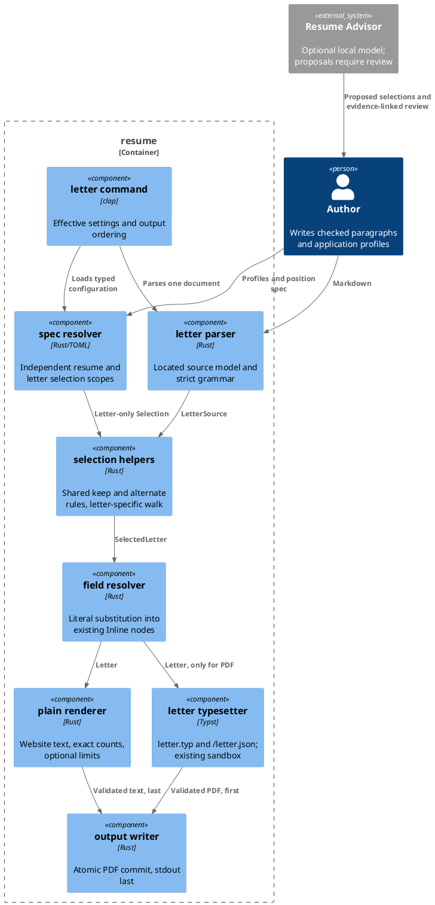

<!-- ABOUTME: Defines the proposed cover-letter architecture and its compatibility contract. -->
<!-- ABOUTME: Records Oracle-reviewed decisions; raw feedback is preserved in the companion analysis. -->
# Cover letters: architecture and design

Date: 2026-11-20 UTC.
Status: planning baseline, not implemented; author-facing defaults require confirmation at implementation claim.

## Context and references

The owner wants reusable cover-letter content with the same priority, tags, status and alternate concepts as resume content.
Most submissions need pasted plain text; styled PDF remains useful for uploads.
One position spec should coordinate both without forcing the same wordings or loading both documents.
The Resume Advisor may propose selections with a local model, but the renderer remains deterministic and offline.

Read this document together with:
- [Analysis and raw Oracle appendices](Cover-Letters-Analysis.md).
- [Implementation plan](Cover-Letters-Implementation-Plan.md).
- [Test plan](Cover-Letters-Test-Plan.md).
- Existing tasks rsm-141.22 (tailoring), rsm-141.23 (position specs), and rsm-eam (advisor).
- `ref/Resume-RS-Architecture.md`, especially model/schema, Markdown, style sandbox and diagnostic streams.

Precedence: this document and its incorporated decision record override the second Oracle report, which overrides the first.
The final review findings F1-F7 are resolved in this baseline and the task contracts.
Raw feedback is evidence, not a second competing implementation specification.

## Verified current state

The checkout is wip/rsm-141.18; main dee46ac contains CLI APIs missing from that worktree.
Oracle inspected main via read-only `git show`, not an assumed current-checkout API.
Implementation tasks must inspect an approved integration base containing main's APIs before editing; planning does not authorize a branch switch or rebase.

The project is one `resume` crate, edition 2024, MSRV 1.92.
It uses pulldown-cmark, snafu, strum, nutype, serde, clap, and pinned Typst 0.15.1.
`src/model/mod.rs` defines Resume and Inline serialized to schema 1 at `/resume.json`.
`src/markdown/` separates tree construction from resume interpretation and produces located diagnostics.
`src/style.rs` requires `style.typ`; `src/typeset/` owns the sandboxed world, fonts and deterministic export.
Main's `src/commands/build.rs` and `src/output.rs` provide the build pipeline and per-file atomic writer.
Global `--format json` owns stdout for diagnostic JSON lines.
Tailoring and specs are OPEN plans, not implemented modules in the inspected tree.
Exact source citations and inspection limitations are retained in the raw reports.

## Boundaries and flow

```text
letter Markdown -> located LetterSource -> selection -> SelectedLetter
                                                       |
position fields / flags ---------------------------> resolve
                                                       |
                                                    Letter
                                                       |
                                    plain text + counts + limit check
                                                       |
                         optional PDF compile, page check, atomic commit
                                                       |
                                      stderr summary, then text stdout
```

Text-only execution never prepares fonts, resolves a style on disk, or initializes Typst.
The PDF and text represent the same selected body; the PDF additionally includes the authored contact/header and explicit date/address fields.
No LLM dependency or network client is added to `resume`.



## Proposed source grammar

```markdown
# Alex Example

[alex@example.invalid](mailto:alex@example.invalid)

## Greeting

Dear Hiring Team,

## Body

I am applying for the {{title}} role at {{company}}.

My platform engineering work combines technical direction and team leadership.

## Closing

Sincerely,
```

The contact paragraph is optional for letters.
The three case-sensitive headings are required, in order, and never appear in rendered output.
The name is the signature.
Body selection operates on complete paragraphs, not sentences.
A greeting/closing contains one paragraph or one adjacent alternate group; body contains one or more items.
No lists, nested headings, arbitrary slots, front matter or template expressions are added in this version.
An unsupported construct is diagnosed, not silently discarded.

After tailoring is available, a body group may be authored as:

```markdown
I lead platform architecture across teams. <!-- =evidence.default @core -->

I build and operate shared AI infrastructure. <!-- =evidence.technical #ai -->

I translate platform investments into delivery outcomes. <!-- =evidence.business #leadership -->
```

One default per group, unique variants, group IDs unique within a document, and no group across section boundaries.
Reuse the upstream rules for group metadata and selected-draft variants.
Do not assume core overrides draft status.

## Proposed model and module design

All paths in this section are proposed unless already identified above.
Keep these within the existing crate, under `src/letter/`, with parser interpretation in `src/markdown/letter.rs`.
Use typed snafu errors for operational failures and the existing diagnostic representation for located content errors.
Enums with string forms use strum and explicit serde naming where serialized.
Validated field types use nutype; no general-purpose template engine is needed.

```rust
// Names are the target contract; imports and diagnostic aliases follow the integration base.
#[derive(Debug, Clone, PartialEq, Eq)]
pub struct Piece {
    pub content: Vec<LetterInline>,
    pub range: std::ops::Range<usize>,
}

#[derive(Debug, Clone, PartialEq, Eq)]
pub enum LetterInline {
    Text(String),
    Strong(Vec<LetterInline>),
    Emph(Vec<LetterInline>),
    Link { url: LinkUrl, content: Vec<LetterInline> },
    Code(String),
    Placeholder { key: Placeholder, range: std::ops::Range<usize> },
}

#[derive(Debug, Clone, Copy, PartialEq, Eq, strum::EnumString, strum::Display)]
#[strum(serialize_all = "kebab-case")]
pub enum Placeholder { Company, Title, Recipient }

// E1: greeting/body/closing hold Piece values directly.
// E2: source fields hold items/groups backed by the actual shared annotation API.
#[derive(Debug, Clone, PartialEq, Eq)]
pub struct SelectedLetter {
    pub name: Name,
    pub contact: Vec<Inline>,
    pub greeting: Piece,
    pub body: Vec<Piece>,
    pub closing: Piece,
}

#[derive(Debug, Clone)]
pub struct LetterFields {
    pub company: Option<FieldValue>,
    pub title: Option<FieldValue>,
    pub recipient: Option<FieldValue>,
    pub date: Option<LetterDate>,
}

#[derive(Debug, Clone, Copy, serde::Serialize)]
#[serde(rename_all = "kebab-case")]
pub enum LetterKind { Letter }

#[derive(Debug, Clone, serde::Serialize)]
pub struct Letter {
    pub schema: u32, // constructed as LETTER_SCHEMA_VERSION = 1
    pub kind: LetterKind,
    pub name: Name,
    pub contact: Vec<Inline>,
    pub date: Option<LetterDate>,
    pub recipient: Option<FieldValue>,
    pub company: Option<FieldValue>,
    pub greeting: Vec<Inline>,
    pub body: Vec<Vec<Inline>>,
    pub closing: Vec<Inline>,
}
```

`FieldValue` wraps a trimmed nonempty String, max 120 scalars, no control characters.
`LetterDate` wraps `time::Date` with an explicit ISO `YYYY-MM-DD` wire format.
The source model is located and not a wire contract; only resolved Letter is serialized.
Do not add placeholder variants to `model::Inline`, which would break existing styles.
Recognition belongs to the parser, filling belongs to the resolver, and rendered metadata never contains annotations or placeholder source spans.

## Application spec proposal

```toml
extends = ["principal", "ai-platform"]

[position]
company = "Example Company"
title = "Principal Architect"

[build]
content = "../baselines/resume.md"
style = "pragmatic"

[select]
pick = { gateway = "technical" } # Resume only.

[letter]
content = "../letters/base.md"
recipient = "Hiring Team"
output-format = "text"
max-length = 2000
length-unit = "utf16"

[letter.select]
tags = ["ai", "platform"]
prefer = ["technical"]
pick = { evidence = "technical" } # Letter only.
```

A profile can hold both independent selection tables.
It may contain `[letter.select]`, which implies a parent letter table, but no letter content, recipient, date or output keys.
A spec's letter table requires content; a resume-only spec need not have a letter table.
The same profile chain and merge rules apply separately to each scope.
No shared-pick exception, cross-document content loading or second spec loader is introduced.
TOML shape/type checking is global; content existence, pick lookup and letter field constraints are command-specific.
The resolver must preserve origin and explicit-flag information, including default values supplied by clap.

## Verification and risks

The implementation/test plan maps each invariant to a concrete task and test.
Tests must cover original-byte diagnostic spans, selected-only missing placeholders, reserved annotation rejection before tailoring, counts at boundaries, mixed-format cache identity, stream failures, scoped picks and old resume compatibility.
Use synthetic public fixtures and private owner review separately.

Known limitations: paragraph coherence still needs human review; arbitrary site counters may differ; shell redirection may truncate files before process startup; stdout writes are not atomic; one PDF style is initially supplied.
The design does not promise sentence-level tailoring, general document templates, generated letter prose, live JD fetching or a combined application command.

## Implemented parser policy update

See [Cover-Letters-Parser.md](Cover-Letters-Parser.md) for rsm-5q1.2 and the owner's subsequent syntax decisions.
Literal, numeric/named and mixed HTML-entity placeholder spellings are accepted in allowed text positions with original-source spans.
Explicit backslash escapes and placeholders split across comment/formatting boundaries are errors.
Only actual Markdown comments are annotations; visible escaped/code lookalikes are not instructions.
This update supersedes any conflicting verbatim-only or broad lexical-ban proposal in the raw reports.

## Letter selection library, rsm-vqr.2

`letter::select(&LetterSource, &Selection)` returns a `SelectedLetter` and range-located `LetterReport`.
It calls the resume's `judge`, `judge_group`, `GroupFacts::of` and alternate `resolve` rules unchanged.
The shared unknown-pick inventory reports unknown groups and variants, including groups excluded by scope.
All picked drafts are collected in authored order before any paragraph is selected.
Greeting and closing choose one wording but remain outside tag/core scope filtering; the body is an authored subsequence.
An unavailable frame is an error, and an empty selected body carries its report in `LetterSelectError::EmptyBody`.
Reports reuse shared `Chosen`, `UnknownPick` and `DropReason` values but use original paragraph ranges instead of resume node indexes.
Draft counts follow upstream semantics: they count authored draft wordings, including unchosen or scope-filtered ones.
Selection expects valid parsed groups; malformed Markdown must fail before this library entry point.
Only the resulting selected pieces reach field resolution, preserving original placeholder spans.

The six stable tests documented in `src/select/rules.rs` pin selected-draft behavior.
`tests/letter_select_property_test.rs` compares letter and resume body outcomes and reports across generated scopes, annotations, picks and preferences.
Repeating selection from the same source is deterministic.
Resume-style reselecting of the result is not applicable: `SelectedLetter` intentionally drops selection annotations.
CLI wiring and unknown tag/preference validation remain `rsm-vqr.3`; this library addition does not remove the command's temporary selection-required guard.

## Annotation integration update, rsm-vqr.1

This update supersedes the earlier parser-reservation baseline below.
`LetterSource` now holds `SourceItem` paragraphs or alternate groups; each item retains annotations and original comment ranges.
`SelectedLetter::try_from` accepts only unannotated sources and returns located `SelectionRequired` otherwise, including lone default groups.
The letter command reports that refusal as `letter-selection-required` before resolution, PDF preparation or text output.
Annotation syntax uses the shared `annotation-*` and `alternate-*` findings.
Selection of annotated letters belongs to `rsm-vqr.2`; the command does not guess defaults or publish drafts in its absence.

## Detailed decisions and final review disposition

The following incorporated decision record is authoritative for edge cases and corrections to the raw reports.

<!-- ABOUTME: Consolidates the cover-letter contract and corrects raw Oracle recommendations. -->
<!-- ABOUTME: This planning record is not an implementation or an assertion of owner approval. -->
# Cover-letter planning decisions

Date: 2026-11-20 UTC.
Status: proposed implementation baseline, authorized for planning and Beads creation only.

## Intent and evidence

Build authored cover letters from reusable content, with priority, tags and alternates coordinated through the same application profiles as resumes.
Produce website-ready plain text first and an optional styled PDF.
Keep local-model assistance outside the deterministic renderer.

Oracle reports are `history/cover-letter-oracle-architecture.md` and `history/cover-letter-oracle-plan.md`, both COMPLETE.
Their source references use main at dee46ac, not the checked-out wip/rsm-141.18 worktree.
Implementation tasks must use an approved integration base containing those APIs; do not reset, rebase or switch this shared worktree as part of planning.
`src/letter/`, `src/spec/`, and tailoring helpers do not exist in this checkout.
Paths named for those modules below are proposed, not claims of existing code.

Precedence: this decision record, then the second Oracle report, then the first report.
Raw reports are retained verbatim, including mistakes and superseded recommendations.
The first report's date is preserved; collection occurred on 2026-11-20 UTC.

## Settled planning defaults

1. Use a separate letter model and parser entry, not a generic document framework or a resume section.
   Reuse the Markdown tree, diagnostics, inline output types, style sandbox, fonts, writer, and eventually annotation/selection helpers.
   Resume schema 1, `/resume.json`, existing commands and styles remain compatible.
2. Source grammar is `# Name`, optional contact paragraph, then exactly `## Greeting`, `## Body`, `## Closing` in that order.
   The name supplies the signature.
   Contact omission is valid for letters: do not accidentally inherit the resume's missing-contact error.
   Greeting and closing contain exactly one paragraph or, after tailoring, one adjacent alternate group.
   Body contains one or more such items; headings are not emitted.
   Lists, tables, code blocks, quotes, role headings and page breaks receive located errors in this first version.
3. Define three concrete model stages in `src/letter/`: located source inline nodes including placeholders; selected paragraphs; resolved serializable letter using existing `model::Inline` only.
   `SelectedLetter` has explicit name, contact, greeting Piece, body Vec<Piece>, closing Piece fields; do not leave it as an unspecified alias in implementation.
   Placeholder locations refer to original UTF-8 source bytes and survive smart punctuation and CRLF handling.
4. Recognize only `{{company}}`, `{{title}}`, `{{recipient}}` in letter paragraph text and link labels, including nested emphasis.
   Reject placeholder attempts in header/contact, code spans, and URL destinations explicitly before URL normalization; URL parsing alone does not reliably reject braces.
   Reject malformed or unknown syntax anywhere even in a variant later dropped.
   Missing values are errors only in selected text.
   Trim field edges, require nonempty single-line values of at most 120 Unicode scalars, reject control characters, and insert values literally without reparsing Markdown.
   Inserted values containing brace text remain literal, not recursive placeholders.
   A date is explicit ISO date input, never today's date.
5. E1 does not yet implement annotations: every annotation-shaped comment (first token begins @, # or =) anywhere in a letter is an error.
   This includes name, contact, unsupported blocks and standalone comments; scan before ordinary comment removal.
   Never silently publish text marked draft.
   When rsm-141.22.1 exists, reuse its predicate rather than adding a competing one.
6. E2 uses exactly the established priority, status, tag and alternate resolver semantics.
   The current planned keep rule allows core to bypass tag exclusion, but draft exclusion still wins without drafts enabled.
   Therefore the property is 'eligible core survives', not Oracle's unconditional 'every core survives'.
   Do not change how a selected draft variant falls back: match the upstream contract and test it.
   Greeting/closing allow alternates only, not priority, status or tags; headings/header allow none.
   Group IDs are unique per document, groups cannot cross sections, and variant IDs are unique per group.
   Shared predicates are extracted only as needed for the two document types, not a plugin abstraction.
   Selected body must be nonempty, order stays authored, and coherence requires human reading.
7. Plain output is greeting, blank line, each body paragraph separated by a blank line, blank line, closing, newline, signature, final LF.
   Omit contact, postal header and date in text, retain them in PDF.
   Both source soft and hard line breaks inside paragraphs become spaces; never hard-wrap output.
   Remove emphasis/code markup, not text.
   Default links render label plus URL; collapse only exact label/URL equality, and exact mailto-address equality, never strip a scheme to guess equivalence.
   A non-address mailto label renders `label (address)` so meaningful wording is not lost.
   The address shortcut applies only when the mailto URL has no query or fragment; otherwise retain the full serialized URL, including subject/cc/body parameters, rather than silently discard them.
   Equality and display use the stored URL spelling (including percent encoding and canonical trailing slash); no percent decoding or source-equivalence guessing is performed.
   An empty link label remains empty in text-only mode and renders ` (target)` in text-and-url mode; validation of authored content is upstream.
   An explicit text-only link option emits labels only.
   Keep the parser's existing smart punctuation, but apply no new Unicode normalization or transliteration.
8. Count exact rendered bytes, Unicode scalars, UTF-16 units, whitespace-separated words and LF line breaks.
   Optional max-length has an explicit utf16/scalars/bytes/words unit, defaults to utf16, accepts zero, and never truncates.
   It checks the canonical text even for PDF-only mode when configured.
   Sites vary: no universal claim about browser counters or CRLF submission conversion; document counts as this tool's exact output contract.
9. CLI is additive `resume letter FILE` with `--output-format text|pdf|both` (default text), separate from global diagnostic `--format`.
   Text is stdout, PDF uses the existing atomic file writer, no automatic .txt output.
   JSON diagnostics with text/both is usage error 2; JSON with PDF is allowed.
   Dry-run emits no letter bytes or files, but JSON diagnostic events may still appear when JSON/PDF is selected.
   Text-only never validates style existence or initializes fonts/Typst; syntactically malformed CLI options still error normally.
   Prepare all requested artifacts and check limits before writes; commit PDF first, emit stdout last.
   Output failure is reported: stdout can partially fail, and a committed PDF remains if stdout fails.
   Shell redirection may create/truncate a destination before the program runs; the program cannot promise otherwise.
10. Add optional `letter.typ` capability beside required `style.typ`, one `pragmatic` letter style, and `/letter.json` schema 1 with kind=letter.
    Share sandbox and cache correctly: entrypoint and document path must participate in world/source identity, and alternate resume/letter compilations on one Typesetter cannot reuse wrong content.
    Resume-only layout probes cannot run unchanged on letters; provide document-appropriate page reporting.
    Page count defaults to one; reject over-limit before committing.
    Metadata must not derive from position fields, tags or profiles.
    The ordinary input stem remains the PDF ident as for resumes; do not claim it can never contain company text chosen by a user.
11. Keep `[select]` resume-only, and resolve `[letter.select]` independently over the same ordered profile chain.
    Neither command reads the other's content file or validates the other's group picks.
    Strict schema validation still covers the entire TOML document: ignoring other content does not mean accepting malformed known tables or unknown keys.
    Resume-only specs remain valid and unaffected.
    A profile may contain a letter table holding only select; reject letter content/recipient/date/output keys in profiles.
    This corrects the raw phrase 'allow [letter.select] but forbid [letter]', because TOML nested tables imply their parent.
    In application specs, a letter table requires content; position company/title fill letter fields; build style/paper provide defaults only when PDF is requested.
    Resolve paths relative to the file that declares them, not process cwd.
12. Follow the existing spec CLI's eventual override policy exactly.
    Make its decision an explicit prerequisite to letter CLI integration, do not assume it is already settled.
    If overrides are allowed, use Option-valued CLI settings so clap defaults do not replace explicit spec values; print effective origin/overrides.
    Do not duplicate the profile loader, merge rules or spec diagnostic system.
13. Add one evaluation task under rsm-eam, blocked by the existing resume advisor spike and completed letter --spec CLI.
    Input is JD, resume baseline, letter source and exact built text; output is a proposed letter spec selection and evidence-linked gap/claim review.
    Use two postings with recorded owner corrections and go/no-go assessment, local inference by default, explicit opt-in for remote transfer, no baseline mutation.
    Keep original rsm-eam.1 scope intact; no generated letter prose or advisor product implementation in these deterministic epics.

## Implementation decomposition

Two new top-level epics avoid silently changing rsm-141's existing PDF-only scope.
Relate them to rsm-141, tailoring, specs and advisor through task blockers and nonblocking related links.

E1 deterministic core has six task-sized deliverables:
- D1 located source/resolved models and placeholder resolution (0.75 to 1 day).
- D2 strict letter parser and annotation reservation (1 to 1.5 days), after D1.
- D3 plain renderer and exact limits (0.5 to 1 day), after D1.
- D4 text CLI and output failure contract (0.75 to 1 day), after D2 and D3.
- D5 optional PDF style, typesetter integration and CLI modes (1 to 1.5 days), after D4; no misleading parallel dependency on an unimplemented command.
- D6 public examples, compatibility tests and release documentation (0.5 to 1 day), after D5.

E2 tailoring/spec integration has five deliverables:
- T1 letter annotations/grouping, after D2 and rsm-141.22.1 (0.5 to 1 day).
- T2 letter selection, after T1 and rsm-141.22.2 (0.5 to 1 day).
- T3 shared tailoring CLI args, after T2, D4 and rsm-141.22.3 (0.5 day).
- T4 strict scoped letter specs, after T2, D4 and rsm-141.23.1 (0.75 to 1.25 days).
- T5 --spec command, end-to-end compatibility, examples and release gates, after T3, T4, D6 and rsm-141.23.2 (0.75 to 1 day).

A1 advisor evaluation task under rsm-eam follows rsm-eam.1 and T5 (1 to 1.5 days).
Estimates total E1 4.5 to 7 days, E2 3 to 4.75 days, A1 1 to 1.5 days, excluding upstream work and owner review latency.
Implementation tests belong in each implementation task, not only in final documentation tasks.
No code is implemented by this planning session.

## Verification and remaining decisions

Per-task gates: just check, separate Rust code and test reviews, targeted properties and mutation tests for selection/limits/resolution with explained surviving mutants.
Release gates: just verify on a provisioned macOS environment; native macOS/Windows CI tests, text/PDF determinism using bundled fonts, old resume regressions, owner reading one real text and PDF letter.
Tests use synthetic identities in public fixtures; private applicant data never enters this public repo.
`just verify` recipes were inspected at main dee46ac; not run for this planning-only change.

Defaults above are actionable recommendations, not owner approval of every detail.
The owner may change heading names, supported placeholder keys, utf16 default, and PDF-only length enforcement before parser/spec contracts ship.
No unresolved question blocks writing the plan; implementation should confirm those author-facing choices at claim time.
One real owner-authored cover letter and two target forms will validate ergonomics; this is explicit release evidence, not a claimed result.

## Approved PDF defaults and implementation, rsm-5q1.5

The owner approved these choices after the D5 design review:
- `--out DIR` resolves to `out`, with `<input-stem>-letter.pdf` to avoid the usual resume filename.
- Explicit ISO dates display in US long form; absent dates produce no date line.
- PDF metadata title is `<Name> - Cover letter`, author is `<Name>`; position fields never supply metadata.
- Configured canonical text limits apply to every output mode, including PDF-only.

Letter rendering uses a closed document-kind identity in the existing world.
Both `/resume.json` and `/letter.json` are reserved: the active payload is in memory, the other is unavailable even if present on disk.
The letter command resolves its optional values into existing shared render settings, reusing `Session::open` without a new setup abstraction.
Letter page reporting uses the existing geometry and font checks without resume role or sparse-page heuristics.
Geometry retains the existing measurement limits; it is not a guarantee about every transformed glyph in an arbitrary custom style.
`resume export` remains resume-only; `export-style` includes the optional letter entry.

## Owner-reviewed PDF layout revision

The owner rejected the resume-like centered name/contact header during D6 visual review.
The pragmatic letter now uses full-block formatting: left-aligned, body-sized sender details, compact recipient/company lines, and blank-line separation between distinct letter blocks.
It retains the font family and margins but not the resume header hierarchy or dense paragraph spacing.
Greetings remain authored content; the style does not insert or remove `Dear`.
This follows the block-format structure described by [Purdue OWL](https://owl.purdue.edu/owl/subject_specific_writing/professional_technical_writing/basic_business_letters/index.html).
The Tech Resume Inside Out public contents mention cover letters, but no letter layout recommendation was verified from the book; Standard Resume's public pages did not establish a cover-letter template.
The revised synthetic PDF requires renewed owner review and new determinism evidence; earlier hashes apply to the old layout.

## Final review disposition

Oracle's final review (`history/cover-letter-oracle-final-review.md`, COMPLETE) found seven actionable filing corrections.
All are adopted here and in the filed task contracts:
- F1: T4 also depends on D4, which provides output enums and transitively text-limit types.
- F2: this planning session creates new tracked-eligible `ref/` synthesis, plan, test plan and verbatim raw appendices before handoff; D6 integrates implemented behavior into the user guide and architectural reference later.
  Every bead carries its relevant contract directly, not only a history link.
  Leave the owner's modified `.gitignore` and `ref/Resume-RS-Implementation-Plan.md` untouched.
- F3: apply company/title `FieldValue` constraints only when resolving a letter, not when loading resume specs.
  Structural TOML validation is global; other-document path existence, fields and group picks are command-specific.
  Test a value accepted by the upstream resume spec loader but rejected by the letter field rules, rather than assuming the upstream accepts a particular length.
- F4: eligible core means a core item/group not excluded by the upstream draft rule.
  T2 must cite upstream selected-draft-alternate tests, and stop to resolve the contract with the owner if rsm-141.22.2 closes without specifying that case.
- F5: preserve explicitness of letter style, paper, page limit, output and limit flags as Option values starting in D4/D5, before specs exist; apply defaults only in effective-settings resolution.
- F6: add non-destructive coordination notes to rsm-141.22.1, .22.2 and .22.3 for reusable annotation recognition/grouping, item selection, and clap args.
  Do not add unrelated scope or overwrite existing acceptance criteria.
- F7: D1 owns model construction, field validation, explicit-date handling and placeholder resolution; D2 owns Markdown recognition, original-source spans and syntax errors.
  D1 and D3 build model values directly in tests and do not depend on the parser.

The final review did not end its on-disk file with the expected final-part marker, but its complete Risks & Unknowns section and COMPLETE header are present and its returned response explicitly says THIS IS THE FINAL PART.
The raw file is preserved without inserting a marker into the author's text.
